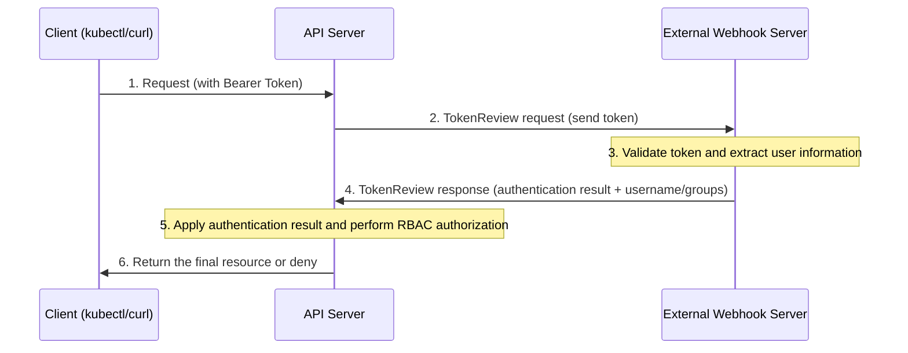

Learn about Webhook Token Authentication in the Kubernetes API Server.

---

## What Is Webhook Token Authentication?

Webhook Token Authentication is a method in which the API server does not perform token authentication itself, but instead **delegates identity verification to an external webhook server**.

### Core Concepts

- **Extensibility:** You can implement complex authentication logic that Kubernetes does not support out of the box.
- **Integration:** You can easily integrate Kubernetes with an in-house LDAP, Active Directory, or an existing authentication system.
- **Delegation:** The API server simply forwards the token and decides whether authentication succeeded based on the external server's response (Success/Fail).

---

## How It Works

Communication between the API server and the external webhook server takes place through a special API object called `TokenReview`.



---

## Configuration Summary

### 1. Create the Webhook Configuration File
You need a configuration file (`webhook-config.yaml`) that defines which webhook server the API server sends data to.

| Item | Description | Note |
|------|------|------|
| **clusters** | Address (URL) and CA certificate of the webhook server | HTTPS recommended |
| **users** | Credentials the API server uses to connect to the webhook server | (Optional) |

### 2. Add API Server Options
Specify the use of the webhook in the `kube-apiserver` configuration on the master node.

```bash
# Example of editing kube-apiserver.yaml
- --authentication-token-webhook-config-file=/etc/kubernetes/pki/webhook-config.yaml
- --authentication-token-webhook-cache-ttl=2m
```

---

## Pros and Cons Summary

| Pros | Cons |
|------|------|
| - Can be fully integrated with the existing in-house authentication system | - Authentication is impossible if the external webhook server fails (SPOF) |
| - Centralized user management is possible | - Network latency may occur |
| - Can be linked with complex security policies (IP restrictions, etc.) | - The burden of building and managing a separate webhook server |

**The Webhook method is a powerful authentication mechanism that offers the most flexibility when integrating Kubernetes with an existing security framework in an enterprise environment.**
