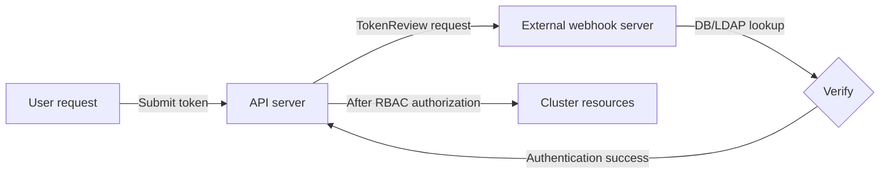

A lab procedure for switching the Kubernetes API server's authentication method to one based on an external webhook server.

---

## Task Overview

This lab extends the API server's default authentication so that it delegates token authentication to an external service.

| Step | Task | Notes |
|------|-----------|------|
| **Prerequisite** | An external webhook server that validates tokens, served over HTTPS, must already be running. | HTTPS-based server |
| **1. Pre-check** | Check the API server's current authentication settings. | `kube-apiserver.yaml` |
| **2. Write the webhook configuration** | Write the configuration file the API server uses when calling the webhook. | `webhook-config.yaml` |
| **3. Apply to the API server** | Modify the API server's startup flags to enable the webhook. | API server restarts |

---

## Authentication Switch Architecture



---

## Step 1: Check the Current Authentication Settings

On the control plane node, check which authentication method the cluster is currently using.

```bash
# Check the API Server configuration file
grep -E "mode|auth" /etc/kubernetes/manifests/kube-apiserver.yaml

# Default configuration example:
# - --authorization-mode=Node,RBAC
# - --client-ca-file=/etc/kubernetes/pki/ca.crt
```

---

## Step 2: Write the Webhook Configuration File (`/etc/kubernetes/pki/webhook-config.yaml`)

Define the address and credentials the API server needs to communicate with the external webhook server. The files are placed under `/etc/kubernetes/pki/` because that directory is already mounted into the kubeadm-generated kube-apiserver Pod; use a dedicated CA and client certificate for the webhook instead of reusing the cluster CA or the API server's own certificate.

```yaml
apiVersion: v1
kind: Config
clusters:
- name: external-auth-service
  cluster:
    server: https://auth.example.com/authenticate # Webhook server address
    certificate-authority: /etc/kubernetes/pki/webhook-ca.crt # CA that signed the webhook server's certificate (not the cluster CA)
users:
- name: kube-apiserver
  user:
    client-certificate: /etc/kubernetes/pki/webhook-client.crt # dedicated client certificate for calling the webhook
    client-key: /etc/kubernetes/pki/webhook-client.key
contexts:
- context:
    cluster: external-auth-service
    user: kube-apiserver
  name: webhook-auth-context
current-context: webhook-auth-context
```

---

## Step 3: Modify the API Server Options

Edit the `kube-apiserver.yaml` file on the control plane node to enable webhook authentication.

```yaml
# Modify /etc/kubernetes/manifests/kube-apiserver.yaml
spec:
  containers:
  - command:
    - kube-apiserver
    ...
    - --authentication-token-webhook-config-file=/etc/kubernetes/pki/webhook-config.yaml
    - --authentication-token-webhook-cache-ttl=5m
```

---

## Cautions and Tips

1.  **Beware of a single point of failure (SPOF):** If the external webhook server goes down, authentication for the whole cluster can be disrupted. A high-availability (HA) setup is recommended.
2.  **Authentication failure logs:** If a problem occurs, check the API server logs (`kubectl logs -n kube-system <apiserver-pod>`) for errors communicating with the webhook server.
3.  **Use caching:** The `--authentication-token-webhook-cache-ttl` option reduces the load on the external server and improves authentication performance.

**Once webhook authentication is set up, you can flexibly integrate the Kubernetes cluster with your organization's centralized authentication system.**
