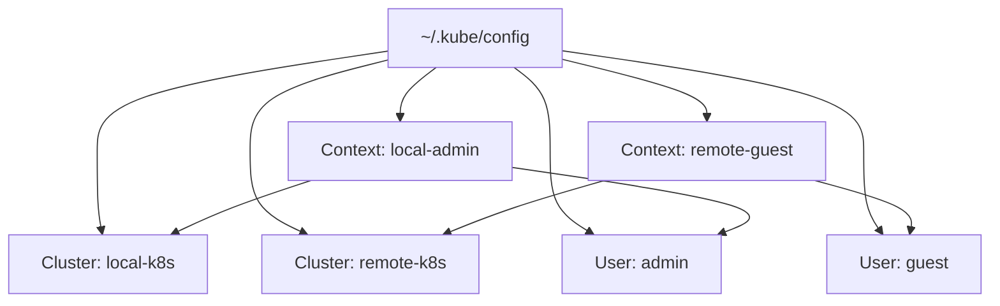

In this lab, you will practice managing and switching between multiple independent Kubernetes clusters with a single `kubectl` tool.

---

## Lab Overview

This lab covers registering a local cluster (`local-k8s`) and a remote cluster (`remote-k8s`) in a single `kubeconfig` file and using them.

| Item | Local cluster (Local) | Remote cluster (Remote) |
|------|-----------------------|------------------------|
| **Cluster name** | `kubernetes` | `remote-k8s` |
| **API server address** | `https://172.31.1.10:6443` | `https://remote.example.com:6443` |
| **User** | `kubernetes-admin` | `guest-user` |
| **Namespace** | `default` | `guest-ns` |

---

## Multi-Cluster Access Architecture

A `kubeconfig` file holds multiple **Cluster**, **User**, and **Context** entries, and you can change the target cluster by switching the Context.



---

## Step 1: Register the Remote Cluster Information

First, register the remote cluster's API server address and the Root CA certificate used to verify it.

```bash
# Register the remote cluster
kubectl config set-cluster remote-k8s \
  --server=https://remote.example.com:6443 \
  --certificate-authority=remote-ca.crt \
  --embed-certs=true
```

---

## Step 2: Register the User Credentials

Register the user's certificate and private key to be used when connecting to the remote cluster.

```bash
# Register the remote user
kubectl config set-credentials guest-user \
  --client-certificate=guest.crt \
  --client-key=guest.key \
  --embed-certs=true
```

---

## Step 3: Create and Switch Contexts

Create a 'context' that links a cluster and a user, then activate it to change the actual connection target.

```bash
# 1. Create the context (cluster + user + default namespace)
kubectl config set-context remote-context \
  --cluster=remote-k8s \
  --user=guest-user \
  --namespace=guest-ns

# 2. Switch the context (change the connection target to the remote cluster)
kubectl config use-context remote-context

# 3. Check the current connection information
kubectl config current-context
kubectl get pods
```

---

## Key Tips

- **Check the configuration:** The `kubectl config view` command shows all the information currently registered in `kubeconfig`.
- **Quick switching:** Using open-source tools such as `kubectx` and `kubens` lets you switch clusters and namespaces much faster from the command line.
- **Security caution:** A `kubeconfig` file may contain private key data (when using embed-certs), so strictly restrict the file permissions to `600`.

**Once you master multi-cluster configuration, you can efficiently manage Kubernetes clusters for multiple environments such as development, staging, and production from a single terminal.**
