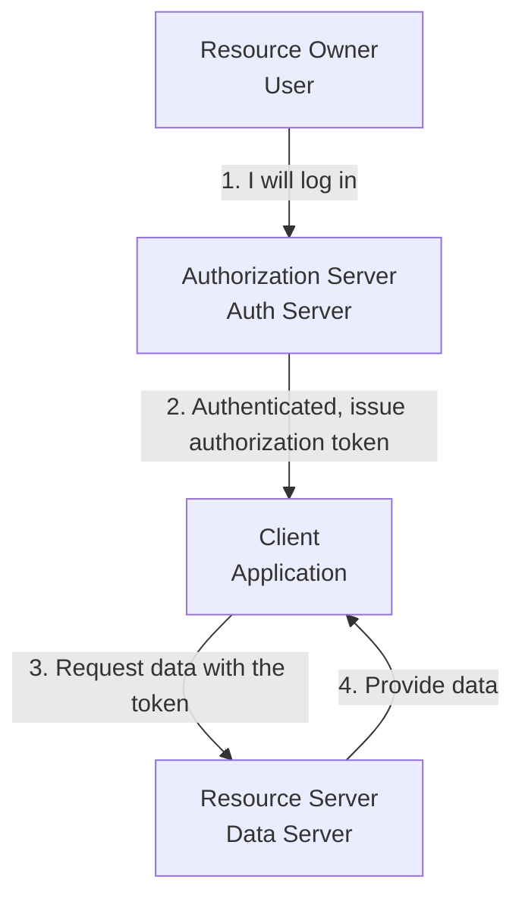

OAuth 2.0 is the most widely used **authorization framework** in modern web and mobile environments. The key idea is that "the user performs authentication, and the application is delegated only limited permissions."

---

## Core Philosophy

> **"Authentication is performed by the user, and authorization is granted to the client."**

This sentence best explains why OAuth 2.0 exists. It lets a third-party app access specific data on your behalf (for example, reading your Google Calendar) without you ever handing over your precious password to that app.

---

## Authentication (AuthN) vs Authorization (AuthZ)

| Category | Authentication | Authorization |
|------|-----------------------|--------------------------|
| **Question** | "Who are you?" | "What can you do?" |
| **Purpose** | Identity verification | Obtaining access rights to resources |
| **Means** | ID/PW, biometrics, OTP | **Access Token** |
| **Subject** | User | Application (Client) |

---

## The 4 Roles in OAuth 2.0

Four parties with different responsibilities appear in the OAuth 2.0 protocol.

1.  **Resource Owner (User):** The owner of the data. (e.g., the owner of a Google account)
2.  **Client (Application):** The app that wants to access the user's data. (e.g., a calendar management app)
3.  **Authorization Server:** The server that authenticates the user and issues the Access Token. (e.g., the Google OAuth server)
4.  **Resource Server:** The server where the user's actual data is stored. (e.g., the Google Calendar API)

---

## Common Grant Types

| Type | Characteristics | Typical Use |
|------|------|------------|
| **Authorization Code** | Strongest security (code exchange) | Typical web server applications |
| **Implicit** | Simple but vulnerable (being phased out) | JavaScript-based single-page apps (SPA) |
| **Resource Owner Password** | Receives the user's password directly (not recommended) | Trusted first-party apps |
| **Client Credentials** | App-to-app communication without a user | Server-to-server API communication (M2M) |

**OAuth 2.0 is not merely a tool that handles login on your behalf; it is a large security framework for safely delegating and managing permissions.**
