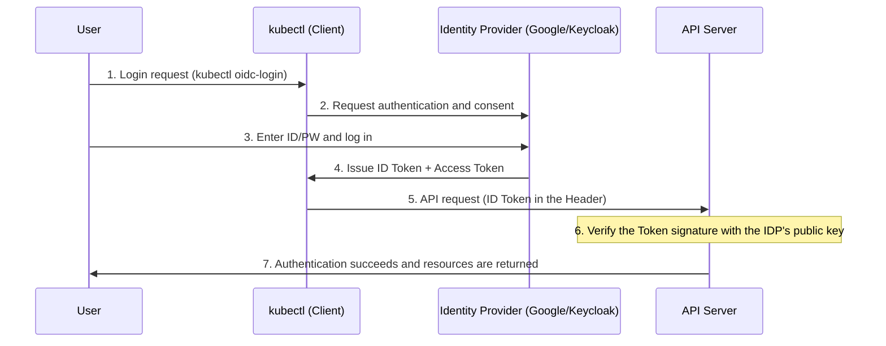

OpenID Connect (OIDC) is a modern authentication standard that adds an **Identity** layer on top of the OAuth 2.0 protocol.

---

## What Is OpenID Connect?

OIDC was designed for Authentication, which verifies "who the user is". While OAuth 2.0 focuses on authorization, OIDC builds on that foundation to securely deliver the user's profile information.

### OAuth 2.0 vs OpenID Connect

| Category | OAuth 2.0 | OpenID Connect (OIDC) |
|------|-----------|-----------------------|
| **Purpose** | Authorization | Identity authentication (Authentication) |
| **Core question** | "What can they do?" | "Who are they?" |
| **Issued artifact** | Access Token (for data access) | **ID Token (contains user information)** |
| **Analogy** | An access card for a specific room | An ID card with a photo |

> **Formula:** OpenID Connect = OAuth 2.0 + Identity Layer

---

## The Core of OIDC: The ID Token

The most important element in OIDC is the **ID Token**. It follows the JSON Web Token (JWT) format and is digitally signed by the issuer (CA), so it cannot be forged or tampered with.

### Inside an ID Token (JWT Claims)

| Claim | Meaning | Example |
|--------|------|------|
| **iss (Issuer)** | The authority that issued the token (IdP) | `https://accounts.google.com` |
| **sub (Subject)** | The user's unique identifier | `1029384756` |
| **aud (Audience)** | The app the token is intended for | `my-k8s-cluster` |
| **exp (Expiration)** | Token expiration time | `1672531200` |
| **email** | The user's email address | `user@example.com` |

---

## OIDC Authentication Flow

This is the authentication flow mainly used when integrating with Kubernetes.

---

## Why Kubernetes Prefers OIDC

1.  **Centralized management:** When someone leaves the company or changes departments, you only need to deactivate the account in the IdP (Google, Okta, etc.) without touching Kubernetes settings, and access is blocked immediately.
2.  **Security:** Unlike the certificate approach, tokens have a short lifetime (usually 1 hour), and MFA (multi-factor authentication) can be enforced.
3.  **User convenience:** Users can log in to Kubernetes with the accounts they already use at the company. (SSO implementation)

**OIDC is the standard approach for managing user security of Kubernetes clusters in enterprise environments in the most modern and secure way.**
