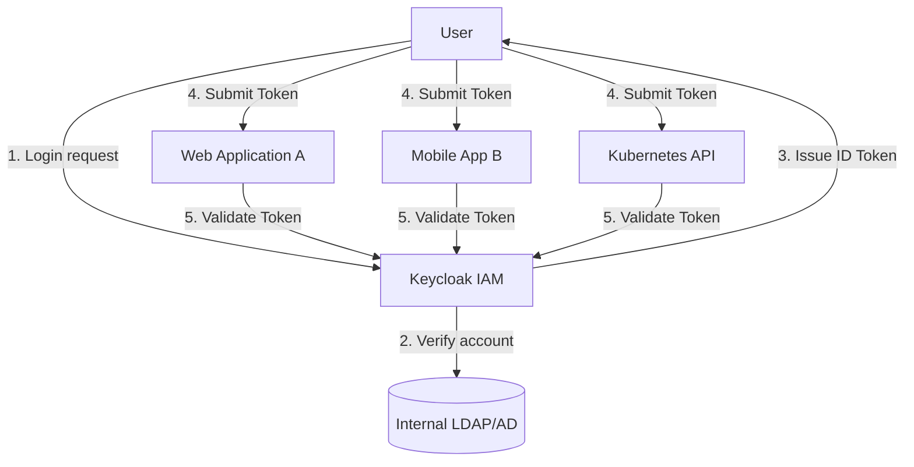

Keycloak is an open-source Identity and Access Management (IAM) solution with the most robust implementation of the OIDC (OpenID Connect) and OAuth 2.0 standards.

---

## What Is Keycloak?

Keycloak provides a complete **"server software dedicated to authentication and authorization"**, so you don't need to develop login logic yourself. It is developed primarily by Red Hat, making it a trusted tool even in enterprise environments.

### Comparison of Key Roles

| Role | Description | Example |
|------|------|------|
| **Identity Provider** | Manages user account information and verifies identity | ID/password verification, sign-up, session management |
| **User Federation** | Integrates with account information from existing internal systems | LDAP, Active Directory (AD) connection |
| **Identity Brokering** | Connects to external social login services | Google, GitHub login integration |
| **Single Sign-On (SSO)** | Use all connected apps with a single login | Logging in to company email automatically logs in to the groupware too |

---

## Keycloak Architecture and SSO Flow

Keycloak acts as a central authentication hub for multiple services.

---

## Summary of Key Features

1.  **Standard protocol support:** Fully supports OpenID Connect, OAuth 2.0, and SAML 2.0.
2.  **Centralized management:** Control users, permissions, and clients in one place through the admin console.
3.  **Strong security settings:** Easily configure MFA (multi-factor authentication), password policies, session timeouts, and more.
4.  **Customizable UI:** Customize the login screen and themes to match corporate branding.

---

## Synergy with Kubernetes

The Kubernetes API server natively supports OIDC authentication. Setting up Keycloak as Kubernetes's IdP provides the following benefits.

- **Internal account integration:** Use `kubectl` with existing company accounts without issuing separate certificates
- **Automated permission management:** Control permissions by linking Keycloak 'Group' information with Kubernetes 'RBAC'
- **Enhanced security:** Maximize cluster access security through short-lived tokens and MFA

**Keycloak is the best choice for any organization looking to standardize and modernize a complex authentication system.**
