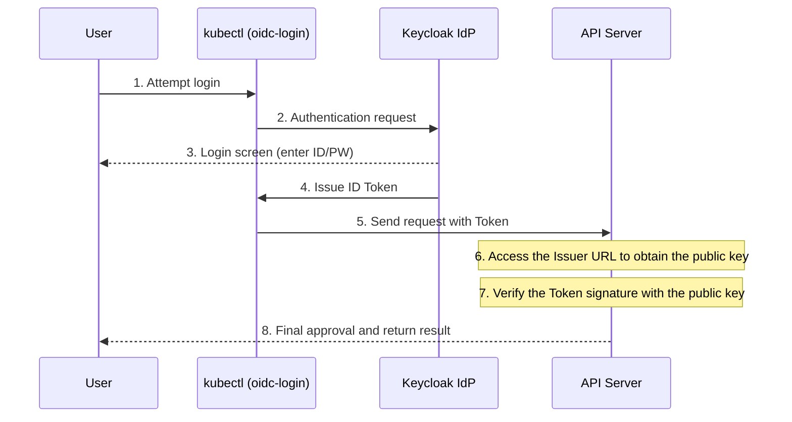

In this lab, you integrate the Kubernetes API server with Keycloak, an external IAM solution, to enable **OpenID Connect (OIDC)** authentication.

---

## Lab Overview

In this lab, you configure the API server to trust ID Tokens issued by Keycloak and to identify users through them.

| Item | Details | Notes |
|------|-----------|------|
| **Issuer URL** | `https://keycloak.example.com/auth/realms/edu` | Address of the token issuer |
| **Client ID** | `kubernetes-cluster` | Client ID registered in Keycloak |
| **Username Claim** | `preferred_username` | Field for the user name in the token |
| **Groups Claim** | `groups` | Field for group information in the token |

---

## OIDC Integration Architecture



---

## Step 1: Add OIDC Options to the API Server

Register the Keycloak information in the `kube-apiserver.yaml` file on the master node.

```yaml
# /etc/kubernetes/manifests/kube-apiserver.yaml
spec:
  containers:
  - command:
    - kube-apiserver
    ...
    # Add OIDC settings
    - --oidc-issuer-url=https://keycloak.example.com/auth/realms/edu
    - --oidc-client-id=kubernetes-cluster
    - --oidc-username-claim=preferred_username
    - --oidc-groups-claim=groups
    - --oidc-ca-file=/etc/kubernetes/pki/keycloak-ca.crt # For verifying Keycloak TLS
```

---

## Step 2: RBAC Permission Mapping

Even if a Keycloak user authenticates successfully, they cannot perform any actions without permissions. Assign Kubernetes permissions based on Keycloak group names.

```yaml
# keycloak-admin-binding.yaml
apiVersion: rbac.authorization.k8s.io/v1
kind: ClusterRoleBinding
metadata:
  name: oidc-admin-group
subjects:
- kind: Group
  name: "/kubernetes-admins" # Group name received from Keycloak
  apiGroup: rbac.authorization.k8s.io
roleRef:
  kind: ClusterRole
  name: cluster-admin
  apiGroup: rbac.authorization.k8s.io
```

---

## Cautions

1.  **Time synchronization:** If the clocks of the API server and the Keycloak server do not match, validation of the token's `iat` or `exp` may fail. (NTP is required)
2.  **HTTPS required:** For security, OIDC must operate in an HTTPS (TLS) environment.
3.  **Verify the Client ID:** The `Client ID` in the Keycloak configuration must exactly match the API server's `--oidc-client-id` value.

**Once the Keycloak integration is complete, you are freed from the burden of managing individual certificates inside the cluster and can manage accounts centrally at the enterprise level.**
