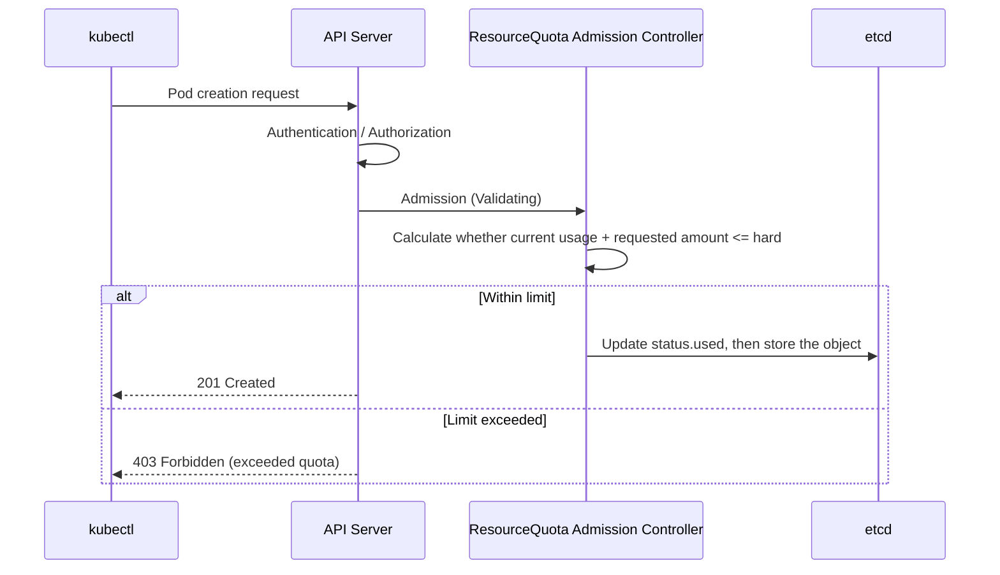

> 📎 Reference: <https://lnkd.in/gUyxKGiZ>

We look at how `ResourceQuota`, which limits **total resources** and **object counts** per namespace, is actually enforced.

---

## 1. Core Concepts

| Item | Description |
|------|------|
| **ResourceQuota** | Limits the namespace-wide totals of CPU/memory/storage and the number of objects (Pod, Service, PVC, etc.) |
| **LimitRange** | Specifies defaults and minimum/maximum values for individual Pods/containers |
| **When applied** | Checked only at **resource create/update request time** (Admission). Does not kill Pods that are already running |

---

## 2. Enforcement Flow (Admission Stage)



1. When a request reaches the API Server, it passes authentication and authorization.
2. The **ResourceQuota Admission Controller** adds the requested amount to the namespace's `status.used` and compares the result with `spec.hard`.
3. If the limit is exceeded, the request is **rejected immediately** (403); if it is within the limit, the `used` value is updated and the object is stored.
4. A separate quota controller periodically recalculates `used` to keep it in line with the actual values.

---

## 3. Example

```yaml
apiVersion: v1
kind: ResourceQuota
metadata:
  name: team-a-quota
  namespace: team-a
spec:
  hard:
    requests.cpu: "4"
    requests.memory: 8Gi
    limits.cpu: "8"
    limits.memory: 16Gi
    pods: "20"
    persistentvolumeclaims: "5"
```

```bash
kubectl describe resourcequota team-a-quota -n team-a
```

---

## 4. Pitfalls You Must Know

- **Pods without requests/limits are rejected.**
  If the quota includes `requests.cpu` and similar fields, every Pod must specify those values. → Providing defaults with a `LimitRange` solves this.
- **The Deployment is created, but its Pods do not start.**
  Because the quota check happens at Pod creation time, you will see `FailedCreate` in the ReplicaSet events.
  ```bash
  kubectl describe rs <name> | grep -i quota
  kubectl get events -n team-a --sort-by=.lastTimestamp
  ```
- **Reducing a quota keeps existing Pods running**, and only blocks new creations.
- With `scopeSelector` (e.g., `PriorityClass`, `Terminating`), you can apply the quota only to Pods in a specific scope.

---

## 5. Summary

> ResourceQuota = **"a namespace-level cap on totals"**, checked **at Admission time**, and violations are **rejected immediately with a 403**.
