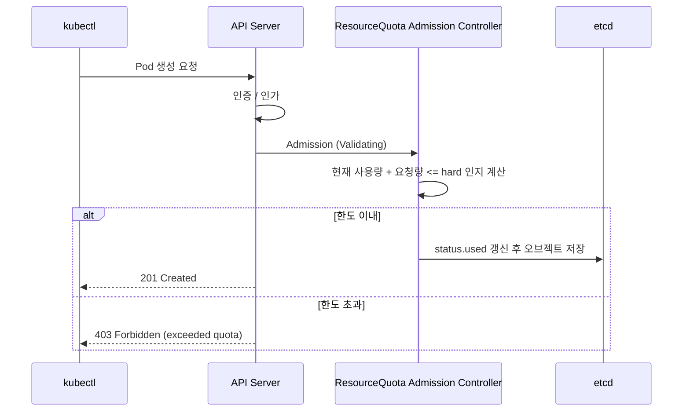

> 📎 참고 자료: <https://lnkd.in/gUyxKGiZ>

네임스페이스 단위로 **리소스 총량**과 **오브젝트 개수**를 제한하는 `ResourceQuota` 가 실제로 어떻게 강제되는지 살펴봅니다.

---

## 1. 핵심 개념

| 항목 | 설명 |
|------|------|
| **ResourceQuota** | 네임스페이스 전체의 CPU/메모리/스토리지 합계, 오브젝트 수(Pod, Service, PVC 등)를 제한 |
| **LimitRange** | 개별 Pod/컨테이너의 기본값(default)과 최소·최대 값을 지정 |
| **적용 시점** | 리소스 **생성/수정 요청 시점**(Admission)에만 검사. 이미 실행 중인 Pod 를 죽이지 않음 |

---

## 2. 적용 흐름 (Admission 단계)



1. 요청이 API Server 에 도착하면 인증/인가를 통과합니다.
2. **ResourceQuota Admission Controller** 가 해당 네임스페이스의 `status.used` 와 요청량을 더해 `spec.hard` 와 비교합니다.
3. 초과하면 요청을 **즉시 거부**(403)하고, 이내이면 `used` 값을 갱신하고 저장합니다.
4. 별도의 quota controller 가 주기적으로 `used` 를 재계산하여 실제 값과 맞춥니다.

---

## 3. 예제

```yaml
apiVersion: v1
kind: ResourceQuota
metadata:
  name: team-a-quota
  namespace: team-a
spec:
  hard:
    requests.cpu: "4"
    requests.memory: 8Gi
    limits.cpu: "8"
    limits.memory: 16Gi
    pods: "20"
    persistentvolumeclaims: "5"
```

```bash
kubectl describe resourcequota team-a-quota -n team-a
```

---

## 4. 반드시 알아야 할 함정

- **requests/limits 가 없는 Pod 는 거부됩니다.**
  quota 가 `requests.cpu` 등을 포함하면 모든 Pod 는 해당 값을 명시해야 합니다. → `LimitRange` 로 기본값을 주면 해결됩니다.
- **Deployment 는 생성되지만 Pod 가 안 뜹니다.**
  Quota 검사는 Pod 생성 시점에 일어나므로 ReplicaSet 이벤트에서 `FailedCreate` 가 보입니다.
  ```bash
  kubectl describe rs <name> | grep -i quota
  kubectl get events -n team-a --sort-by=.lastTimestamp
  ```
- **Quota 를 줄여도 기존 Pod 는 유지**되며, 신규 생성만 막힙니다.
- `scopeSelector`(예: `PriorityClass`, `Terminating`)로 특정 범위의 Pod 에만 quota 를 적용할 수 있습니다.

---

## 5. 정리

> ResourceQuota = **"네임스페이스 단위 총량 제한"**, 검사는 **Admission 시점**, 위반 시 **403 으로 즉시 거부**.
