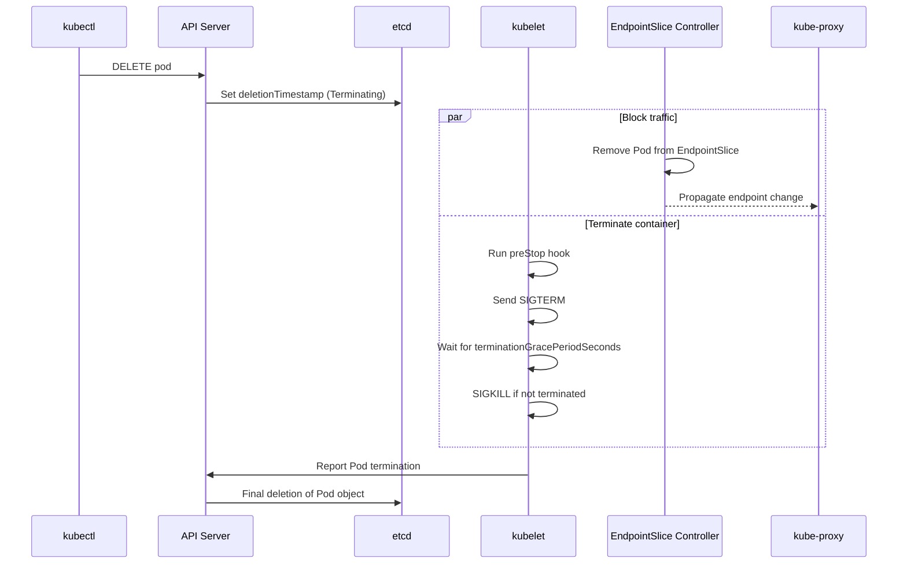

> 📎 Reference: <https://lnkd.in/gaqp7-Xg>

See what happens internally when you run `kubectl delete pod`, and why **Graceful Shutdown** settings matter.

---

## 1. Overall Flow



1. **Delete request**: The API Server does not remove the Pod immediately; it sets `metadata.deletionTimestamp` (status: `Terminating`).
2. **Endpoint removal**: The EndpointSlice controller removes the Pod from the Service's backend list.
3. **kubelet termination handling**: `preStop` hook → `SIGTERM` → wait for the grace period → `SIGKILL`.
4. **Final deletion**: When the kubelet reports termination, the API Server deletes the object from etcd.

> ⚠️ Steps 2 and 3 proceed **in parallel**. This means SIGTERM can arrive before endpoint propagation has finished, and some requests may flow into the terminating Pod in the meantime.

---

## 2. Important Settings

```yaml
spec:
  terminationGracePeriodSeconds: 30   # Default is 30 seconds
  containers:
  - name: app
    lifecycle:
      preStop:
        exec:
          command: ["sh", "-c", "sleep 5"]   # Buys time for endpoint propagation
```

| Setting | Role |
|------|------|
| `terminationGracePeriodSeconds` | The time allowed between SIGTERM and SIGKILL |
| `preStop` hook | Runs before SIGTERM. Used for connection draining, a short sleep, etc. |
| `kubectl delete --grace-period=0 --force` | Immediately removes from the API without a grace period (containers may remain on the node, so this is **dangerous**) |

---

## 3. When a Pod Is Stuck in Terminating

| Cause | Check/Action |
|------|-----------|
| The app ignores SIGTERM (PID 1 problem) | Use `exec` instead of a shell script, implement a signal handler |
| A **Finalizer** remains | `kubectl get pod <p> -o jsonpath='{.metadata.finalizers}'` |
| The node is `NotReady` | The kubelet is unresponsive → recover the node or force delete |
| Volume detach delay | Check the CSI driver logs |

```bash
kubectl delete pod <name> --grace-period=0 --force   # Last resort
```

---

## 4. Summary

> Deletion = **set deletionTimestamp → remove Endpoint + (preStop → SIGTERM → SIGKILL) → delete from etcd**.
> If you want zero-downtime deployments, be sure to design for `preStop sleep` and SIGTERM handling.
