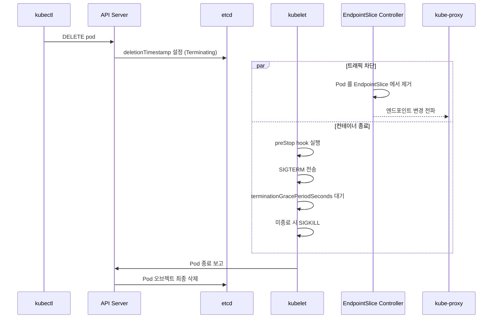

> 📎 참고 자료: <https://lnkd.in/gaqp7-Xg>

`kubectl delete pod` 를 실행하면 내부에서 어떤 일이 일어나는지, 그리고 왜 **Graceful Shutdown** 설정이 중요한지 살펴봅니다.

---

## 1. 전체 흐름



1. **삭제 요청**: API Server 가 Pod 를 즉시 지우지 않고 `metadata.deletionTimestamp` 를 설정합니다 (상태: `Terminating`).
2. **Endpoint 제거**: EndpointSlice 컨트롤러가 Service 의 백엔드 목록에서 Pod 를 제거합니다.
3. **kubelet 종료 처리**: `preStop` 훅 → `SIGTERM` → 유예 시간 대기 → `SIGKILL`.
4. **최종 삭제**: kubelet 이 종료를 보고하면 API Server 가 etcd 에서 오브젝트를 삭제합니다.

> ⚠️ 2번과 3번은 **병렬**로 진행됩니다. 즉 엔드포인트 전파가 끝나기 전에 SIGTERM 이 도착할 수 있고, 이때 일부 요청이 종료 중인 Pod 로 유입될 수 있습니다.

---

## 2. 중요한 설정

```yaml
spec:
  terminationGracePeriodSeconds: 30   # 기본값 30초
  containers:
  - name: app
    lifecycle:
      preStop:
        exec:
          command: ["sh", "-c", "sleep 5"]   # 엔드포인트 전파 시간을 벌어줌
```

| 설정 | 역할 |
|------|------|
| `terminationGracePeriodSeconds` | SIGTERM 이후 SIGKILL 까지 허용하는 시간 |
| `preStop` hook | SIGTERM 전에 실행. 연결 드레인, 짧은 sleep 등에 사용 |
| `kubectl delete --grace-period=0 --force` | 유예 없이 API 에서 즉시 제거 (노드의 컨테이너는 남을 수 있어 **위험**) |

---

## 3. Pod 가 Terminating 에서 멈출 때

| 원인 | 확인/조치 |
|------|-----------|
| 앱이 SIGTERM 을 무시 (PID 1 문제) | 쉘 스크립트 대신 `exec` 사용, 시그널 핸들러 구현 |
| **Finalizer** 가 남아 있음 | `kubectl get pod <p> -o jsonpath='{.metadata.finalizers}'` |
| 노드가 `NotReady` | kubelet 응답 불가 → 노드 복구 또는 강제 삭제 |
| 볼륨 detach 지연 | CSI 드라이버 로그 확인 |

```bash
kubectl delete pod <name> --grace-period=0 --force   # 최후의 수단
```

---

## 4. 정리

> 삭제 = **deletionTimestamp 설정 → Endpoint 제거 + (preStop → SIGTERM → SIGKILL) → etcd 삭제**.
> 무중단 배포를 원한다면 `preStop sleep` 과 SIGTERM 핸들링을 반드시 설계하세요.
