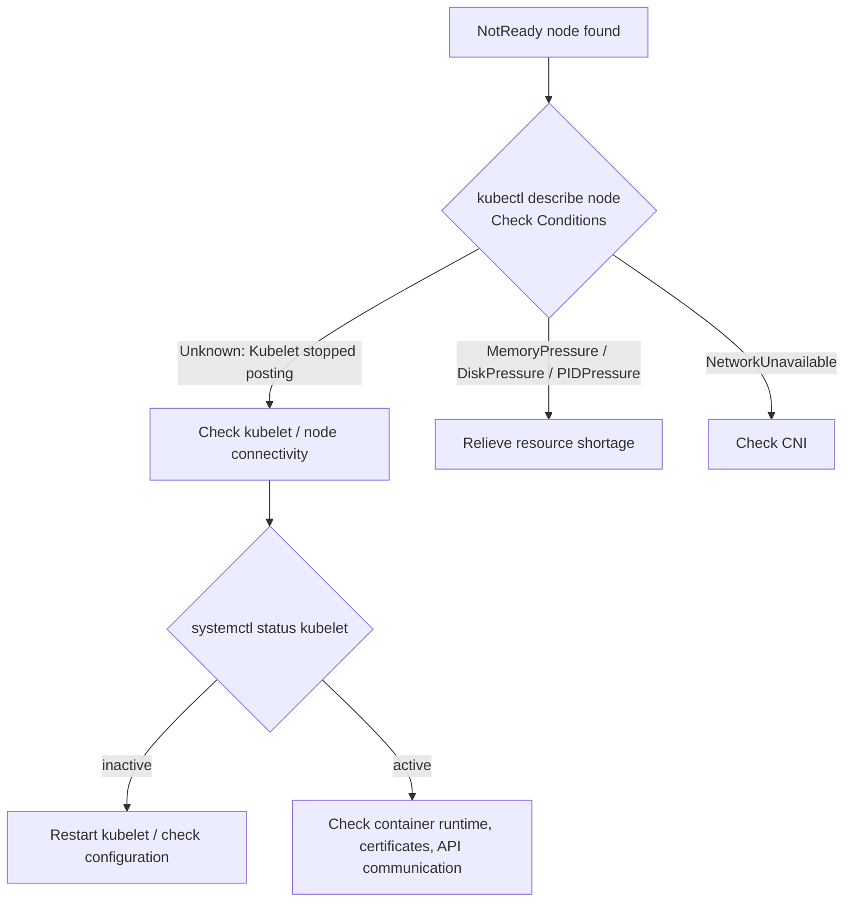

> 📎 Reference: <https://lnkd.in/gdH9SVuN>

A troubleshooting procedure that systematically narrows down the causes of a node going into the `NotReady` state.

---

## 1. What Is NotReady?

This is the state where the kubelet fails to periodically report its status (Lease/NodeStatus) to the API Server, or the reported **Ready condition is False/Unknown**. After a certain period (a 40-second grace by default), the Node Controller marks the node as `NotReady` and then evicts the Pods on that node.



---

## 2. Step-by-Step Checks

### Step 1. Check the Conditions
```bash
kubectl get nodes
kubectl describe node <node> | sed -n '/Conditions/,/Addresses/p'
kubectl get events --field-selector involvedObject.name=<node>
```

### Step 2. Log in to the node and check the kubelet
```bash
systemctl status kubelet
journalctl -u kubelet -n 100 --no-pager
```

### Step 3. Check the container runtime
```bash
systemctl status containerd
crictl ps
crictl info
```

### Step 4. Check for resource shortage
```bash
df -h        # DiskPressure (/var/lib/kubelet, /var/lib/containerd)
free -m      # MemoryPressure
```

### Step 5. Network / CNI / certificates
```bash
ls /etc/cni/net.d/
kubectl get pods -n kube-system -o wide | grep <node>
openssl x509 -in /var/lib/kubelet/pki/kubelet-client-current.pem -noout -dates
curl -k https://<apiserver>:6443/healthz
```

---

## 3. Table of Common Causes

| Symptom (Log/Condition) | Cause | Action |
|--------------------|------|------|
| `Kubelet stopped posting node status` | kubelet is down | `systemctl restart kubelet`, check logs |
| `container runtime is down` | containerd failure | Restart the runtime |
| `DiskPressure=True` | Disk usage exceeded the threshold | Clean up images/logs (`crictl rmi --prune`) |
| `MemoryPressure=True` | Node is out of memory | Move workloads, adjust limits |
| `cni plugin not initialized` | CNI not installed/misconfigured | Check the CNI DaemonSet |
| `x509: certificate has expired` | kubelet certificate expired | Renew the certificate (see doc 28) |
| swap enabled | kubelet fails to start | `swapoff -a` and edit `/etc/fstab` |

---

## 4. Verification After Recovery

```bash
kubectl uncordon <node>      # Release it if you had cordoned the node
kubectl get nodes -w
```

> If recovery is not possible, run `kubectl drain <node> --ignore-daemonsets --delete-emptydir-data` and then replace the node.
