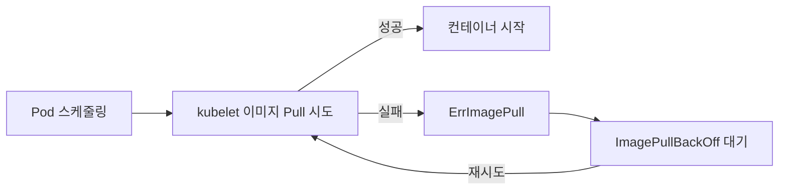
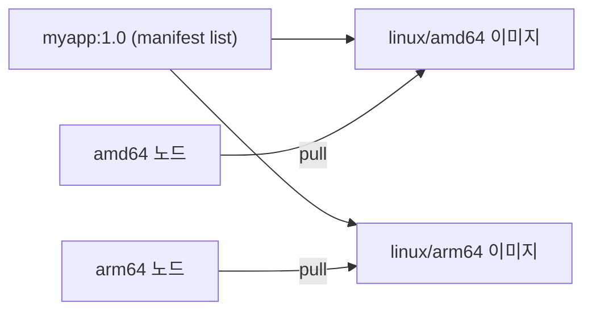

> 📎 참고 자료: <https://lnkd.in/gW8Q9c29>

Pod 가 `ErrImagePull` → `ImagePullBackOff` 상태가 되는 이유와 해결법입니다.

---

## 1. 상태의 의미

| 상태 | 의미 |
|------|------|
| `ErrImagePull` | 이미지를 가져오는 시도가 **실패**한 순간 |
| `ImagePullBackOff` | 실패 후 kubelet 이 **지수 백오프**(10s, 20s, 40s … 최대 5분)로 재시도 대기 중 |



---

## 2. 진단 순서

```bash
kubectl get pod <pod>
kubectl describe pod <pod>      # Events 의 Failed / Back-off 메시지가 핵심
```

Events 예시:
```
Failed to pull image "myapp:v2": rpc error: code = NotFound ... not found
Failed to pull image "registry.example.com/app": ... pull access denied, authorization failed
```

---

## 3. 원인별 해결

| 원인 | 메시지 단서 | 해결 |
|------|-------------|------|
| **이미지/태그 오타** | `not found`, `manifest unknown` | 이름·태그 수정 (`latest` 남용 주의) |
| **프라이빗 레지스트리 인증 실패** | `unauthorized`, `pull access denied` | `imagePullSecrets` 설정 |
| **레지스트리 접근 불가** | `i/o timeout`, `no such host` | 노드 DNS/방화벽/프록시 점검 |
| **Rate limit** | `toomanyrequests` (Docker Hub) | 로그인 pull, 사설 미러 사용 |
| **아키텍처 불일치** | `no matching manifest for linux/arm64` | 멀티 아키텍처 이미지 사용 (5장 절차 참고) |
| **TLS 인증서 문제** | `x509: certificate signed by unknown authority` | 노드에 CA 신뢰 등록 |

### imagePullSecrets 설정

```bash
kubectl create secret docker-registry regcred \
  --docker-server=registry.example.com \
  --docker-username=<user> \
  --docker-password=<password> \
  -n <namespace>
```

```yaml
spec:
  imagePullSecrets:
  - name: regcred
  containers:
  - name: app
    image: registry.example.com/team/app:1.0.0
```

---

## 4. 노드에서 직접 확인

```bash
crictl pull registry.example.com/team/app:1.0.0
```

> Pod 가 아닌 **노드(kubelet/containerd)** 가 pull 하므로, 노드에서 재현하는 것이 가장 빠릅니다.

---

## 5. 멀티 아키텍처 이미지 사용 절차

`no matching manifest for linux/arm64/v8 in the manifest list entries` 오류는 이미지가 **노드의 CPU 아키텍처(amd64/arm64)용으로 빌드되지 않았을 때** 발생합니다. 멀티 아키텍처 이미지는 하나의 태그 아래 여러 아키텍처 이미지를 묶은 **manifest list(OCI index)** 이며, 런타임이 노드 아키텍처에 맞는 이미지를 자동으로 선택합니다.



### Step 1. 노드 아키텍처 확인
```bash
kubectl get nodes -o custom-columns=NAME:.metadata.name,ARCH:.status.nodeInfo.architecture
```

### Step 2. 이미지가 지원하는 아키텍처 확인
```bash
docker buildx imagetools inspect registry.example.com/team/app:1.0.0
# 또는
docker manifest inspect registry.example.com/team/app:1.0.0 | grep -A3 platform
```
`Platform: linux/amd64`, `linux/arm64` 가 모두 있어야 합니다.

### Step 3. 멀티 아키텍처 이미지 빌드 및 푸시 (buildx)
```bash
# 최초 1회: 멀티 플랫폼 빌더 생성
docker buildx create --name multiarch --use
docker buildx inspect --bootstrap

# 빌드 + 푸시를 한 번에 (멀티 플랫폼 이미지는 로컬에 로드되지 않고 레지스트리로 직접 push)
docker buildx build \
  --platform linux/amd64,linux/arm64 \
  -t registry.example.com/team/app:1.0.0 \
  --push .
```
- QEMU 에뮬레이션으로 빌드하면 느리므로, CI 에서는 아키텍처별 네이티브 러너 사용이나 Dockerfile 의 크로스 컴파일(`--platform=$BUILDPLATFORM`, `TARGETARCH`)을 고려합니다.
- 베이스 이미지도 해당 아키텍처를 지원해야 합니다.

### Step 4. 아키텍처별 이미지를 따로 빌드한 경우 manifest 병합
```bash
docker buildx imagetools create \
  -t registry.example.com/team/app:1.0.0 \
  registry.example.com/team/app:1.0.0-amd64 \
  registry.example.com/team/app:1.0.0-arm64
```

### Step 5. 클러스터에 배포
이미지 태그 하나만 지정하면 각 노드가 자신의 아키텍처에 맞는 이미지를 pull 합니다.
```yaml
spec:
  containers:
  - name: app
    image: registry.example.com/team/app:1.0.0   # manifest list 태그
```
특정 아키텍처 노드에만 배포해야 하는 단일 아키텍처 이미지라면 nodeSelector 로 제한합니다.
```yaml
spec:
  nodeSelector:
    kubernetes.io/arch: arm64
```

### Step 6. 검증
```bash
kubectl get pods -o wide                       # 노드별 Running 확인
crictl pull --platform linux/arm64 registry.example.com/team/app:1.0.0   # 노드에서 직접 재현
```

---

## 6. 예방 팁

- 태그는 불변 버전 또는 digest(`@sha256:...`)를 사용
- `imagePullPolicy` 의미 확인: `IfNotPresent` / `Always` / `Never`
- 사설 레지스트리 secret 은 네임스페이스마다 필요 (ServiceAccount 에 `imagePullSecrets` 연결 가능)
