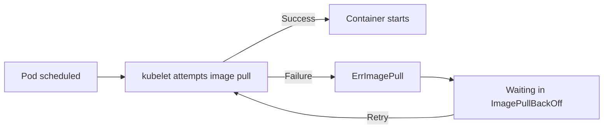
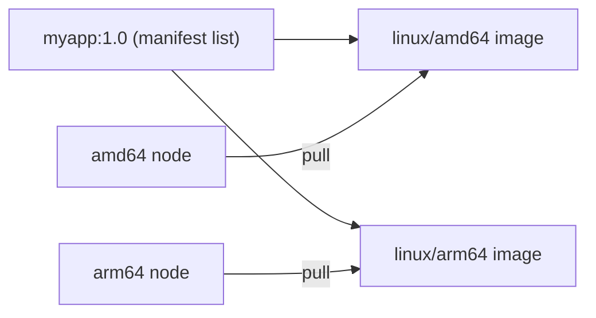

> 📎 Reference: <https://lnkd.in/gW8Q9c29>

Why a Pod ends up in the `ErrImagePull` → `ImagePullBackOff` state, and how to fix it.

---

## 1. What the States Mean

| State | Meaning |
|------|------|
| `ErrImagePull` | An attempt to pull the image has just **failed** |
| `ImagePullBackOff` | After a failure, the kubelet is waiting to retry with **exponential backoff** (10s, 20s, 40s … up to 5 minutes) |



---

## 2. Diagnosis Steps

```bash
kubectl get pod <pod>
kubectl describe pod <pod>      # The Failed / Back-off messages in Events are the key
```

Events example:
```
Failed to pull image "myapp:v2": rpc error: code = NotFound ... not found
Failed to pull image "registry.example.com/app": ... pull access denied, authorization failed
```

---

## 3. Fixes by Cause

| Cause | Message Clue | Fix |
|------|-------------|------|
| **Typo in image/tag** | `not found`, `manifest unknown` | Fix the name and tag (beware of overusing `latest`) |
| **Private registry authentication failure** | `unauthorized`, `pull access denied` | Configure `imagePullSecrets` |
| **Registry unreachable** | `i/o timeout`, `no such host` | Check node DNS/firewall/proxy |
| **Rate limit** | `toomanyrequests` (Docker Hub) | Authenticate when pulling, or use a private mirror |
| **Architecture mismatch** | `no matching manifest for linux/arm64` | Use a multi-architecture image (see the procedure in Section 5) |
| **TLS certificate issue** | `x509: certificate signed by unknown authority` | Add the CA to the node's trust store |

### Configuring imagePullSecrets

```bash
kubectl create secret docker-registry regcred \
  --docker-server=registry.example.com \
  --docker-username=<user> \
  --docker-password=<password> \
  -n <namespace>
```

```yaml
spec:
  imagePullSecrets:
  - name: regcred
  containers:
  - name: app
    image: registry.example.com/team/app:1.0.0
```

---

## 4. Checking Directly on the Node

```bash
crictl pull registry.example.com/team/app:1.0.0
```

> Because the pull is performed by the **node (kubelet/containerd)** rather than the Pod, reproducing it on the node is the fastest way.

---

## 5. Procedure for Using Multi-Architecture Images

The error `no matching manifest for linux/arm64/v8 in the manifest list entries` occurs when the image **was not built for the node's CPU architecture (amd64/arm64)**. A multi-architecture image is a **manifest list (OCI index)** that bundles images for several architectures under a single tag, and the runtime automatically selects the image matching the node's architecture.



### Step 1. Check the Node Architecture
```bash
kubectl get nodes -o custom-columns=NAME:.metadata.name,ARCH:.status.nodeInfo.architecture
```

### Step 2. Check Which Architectures the Image Supports
```bash
docker buildx imagetools inspect registry.example.com/team/app:1.0.0
# or
docker manifest inspect registry.example.com/team/app:1.0.0 | grep -A3 platform
```
Both `Platform: linux/amd64` and `linux/arm64` must be present.

### Step 3. Build and Push a Multi-Architecture Image (buildx)
```bash
# First time only: create a multi-platform builder
docker buildx create --name multiarch --use
docker buildx inspect --bootstrap

# Build and push in one step (multi-platform images are not loaded locally; they are pushed directly to the registry)
docker buildx build \
  --platform linux/amd64,linux/arm64 \
  -t registry.example.com/team/app:1.0.0 \
  --push .
```
- Building with QEMU emulation is slow, so in CI consider using native runners per architecture or cross-compilation in the Dockerfile (`--platform=$BUILDPLATFORM`, `TARGETARCH`).
- The base image must also support the target architectures.

### Step 4. Merge Manifests When Per-Architecture Images Were Built Separately
```bash
docker buildx imagetools create \
  -t registry.example.com/team/app:1.0.0 \
  registry.example.com/team/app:1.0.0-amd64 \
  registry.example.com/team/app:1.0.0-arm64
```

### Step 5. Deploy to the Cluster
Specify a single image tag, and each node pulls the image matching its own architecture.
```yaml
spec:
  containers:
  - name: app
    image: registry.example.com/team/app:1.0.0   # manifest list tag
```
For a single-architecture image that must be deployed only to nodes of a specific architecture, restrict scheduling with a `nodeSelector`.
```yaml
spec:
  nodeSelector:
    kubernetes.io/arch: arm64
```

### Step 6. Verify
```bash
kubectl get pods -o wide                       # Confirm Running on each node
crictl pull --platform linux/arm64 registry.example.com/team/app:1.0.0   # Reproduce directly on the node
```

---

## 6. Prevention Tips

- Use immutable version tags or a digest (`@sha256:...`)
- Understand how `imagePullPolicy` works: `IfNotPresent` / `Always` / `Never`
- The registry Secret must exist in every Namespace that pulls from the private registry (you can attach `imagePullSecrets` to a ServiceAccount)

> 🔗 **Related:** After the image is pulled, container start-up can still fail. See Use Case 9 (CreateContainerError), Use Case 10 (CreateContainerConfigError), and Use Case 11 (RunContainerError).
