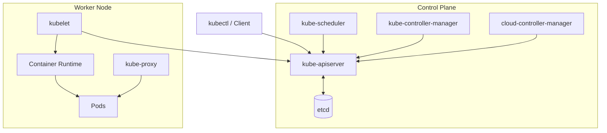
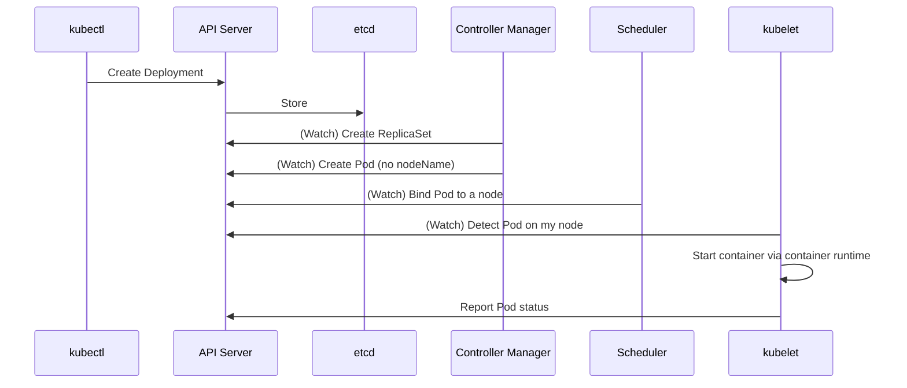

> 📎 Reference: <https://lnkd.in/gseEj3wD>

A quick overview of the components that make up a Kubernetes cluster and how requests are processed. (For details, see the 03-k8s-components document.)

---

## 1. The Big Picture

---

## 2. Component Roles

### Control Plane

| Component | Role |
|----------|------|
| **kube-apiserver** | The center of all communication. Provides authentication, authorization, admission control, and the REST API. The **only** component that talks to etcd |
| **etcd** | A distributed key-value store that holds cluster state (Raft consensus) |
| **kube-scheduler** | Places unassigned Pods on suitable nodes (filtering → scoring) |
| **kube-controller-manager** | Runs controller loops such as Deployment, ReplicaSet, Node, and Job |
| **cloud-controller-manager** | Integrates with the cloud provider's load balancers, nodes, and routes |

### Worker Node

| Component | Role |
|----------|------|
| **kubelet** | The node agent. Runs and monitors containers according to the PodSpec, and reports status |
| **kube-proxy** | Implements a Service's virtual IP with iptables/IPVS rules |
| **Container Runtime** | containerd, CRI-O, etc. Integrates with the kubelet through the CRI |

---

## 3. What Happens in a Single `kubectl apply`

The core principle is **declarative desired state + a watch-based reconcile loop**.

---

## 4. Points to Remember

- Components do not talk to each other directly; they exchange state **only through the API server**.
- etcd failure = loss of cluster control → backups and an HA setup are essential.
- Add-ons (CoreDNS, CNI, Metrics Server, etc.) run on top of the cluster as Pods.
