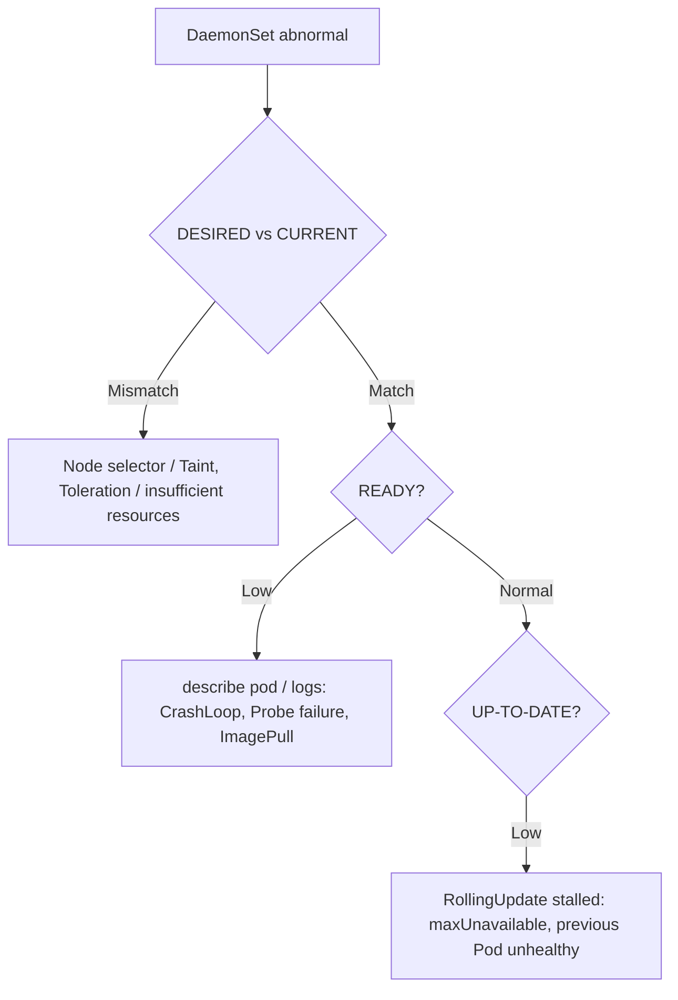

> 📎 Reference: <https://lnkd.in/geGgkXKe>

A DaemonSet runs **one Pod on every (or each selected) node**. It is used for log collectors, CNI, monitoring agents, and the like, so a problem has a wide blast radius.

---

## 1. Read the Numbers First

```bash
kubectl get ds -A
# NAME        DESIRED  CURRENT  READY  UP-TO-DATE  AVAILABLE  NODE SELECTOR
```

| Field | Meaning |
|------|------|
| `DESIRED` | Number of nodes that should be scheduled |
| `CURRENT` | Number of Pods actually created |
| `READY` | Number of Pods in the Ready state |
| `UP-TO-DATE` | Number of Pods updated to the latest template |

`DESIRED ≠ CURRENT` → a **scheduling** problem, `CURRENT ≠ READY` → a **Pod startup/Probe** problem.



---

## 2. Checks by Cause

### (1) Some nodes have no Pod
```bash
kubectl describe ds <name> -n <ns>
kubectl get nodes --show-labels
kubectl describe node <node> | grep -i taint
```
- **Taint**: Tainted nodes such as control-plane nodes require `tolerations`
- **nodeSelector / nodeAffinity** mismatch
- Insufficient node resources (a DaemonSet Pod must also satisfy its requests)

```yaml
spec:
  template:
    spec:
      tolerations:
      - key: node-role.kubernetes.io/control-plane
        operator: Exists
        effect: NoSchedule
```

### (2) Pod is in CrashLoopBackOff / Not Ready
```bash
kubectl logs <pod> -n <ns> --previous
kubectl describe pod <pod> -n <ns>
```
- Permission/path problems with `hostPath`, `hostNetwork`, or `privileged`
- Port conflicts (when using `hostPort`)
- Liveness/Readiness probe misconfiguration

### (3) Rollout is stuck
```bash
kubectl rollout status ds/<name> -n <ns>
kubectl rollout history ds/<name> -n <ns>
```
- Check `updateStrategy.rollingUpdate.maxUnavailable` (default 1)
- If the Pod on one node stays Not Ready, the rollout cannot proceed to the next node
- With the `OnDelete` strategy, you must delete Pods manually

```bash
kubectl rollout undo ds/<name> -n <ns>
```

---

## 3. Troubleshooting Cases

### Case 1. Only the control-plane node has no Pod (Taint)

- **Symptom**: There are 5 nodes (1 control-plane + 4 workers) but `DESIRED=4, CURRENT=4`. The log collector cannot collect control-plane logs.
- **Diagnosis**
  ```bash
  kubectl describe node cp-1 | grep -i taint
  # Taints: node-role.kubernetes.io/control-plane:NoSchedule
  ```
- **Cause**: The DaemonSet does not tolerate the `NoSchedule` taint on the control-plane node.
- **Fix**: Add `tolerations` and run `kubectl apply` → confirm that `DESIRED` increases to 5.

### Case 2. CrashLoopBackOff only on a specific node (hostPath / permissions)

- **Symptom**: `READY` is `DESIRED-1`. Only the Pod on one node is in `CrashLoopBackOff`.
- **Diagnosis**
  ```bash
  kubectl get pods -n logging -o wide | grep -v Running
  kubectl logs <pod> -n logging --previous
  # open /var/log/containers: permission denied  (or no such file or directory)
  ```
- **Cause**: The container runtime on that node uses a different path (`/var/log/pods`), or SELinux/AppArmor blocks hostPath access.
- **Fix**: Make the node configuration consistent or fix the mount path, and adjust `securityContext` if needed. First suspect OS/runtime differences between nodes.

### Case 3. Pod is Pending after adding a new node (insufficient resources)

- **Symptom**: Right after scaling out nodes, the DaemonSet Pod is `Pending` because regular workloads have already filled the node.
- **Diagnosis**
  ```bash
  kubectl describe pod <pod> | grep -A5 Events
  # 0/1 nodes are available: 1 Insufficient cpu.
  ```
- **Cause**: A DaemonSet Pod must also satisfy its `requests` to be scheduled. Regular Pods took the space first.
- **Fix**: Giving the agent `priorityClassName: system-node-critical` lets it preempt lower-priority Pods and get placed. Reducing the requests values themselves is another option.

### Case 4. Rolling update stops midway

- **Symptom**: `UP-TO-DATE` is stuck at 3, and `rollout status` keeps waiting.
- **Diagnosis**
  ```bash
  kubectl rollout status ds/node-agent -n monitoring
  kubectl get pods -n monitoring -o wide     # Check for Not Ready among the new-version Pods
  ```
- **Cause**: The readinessProbe of the new image fails (bad configuration value) → because `maxUnavailable: 1`, the rollout cannot proceed to the next node.
- **Fix**: Immediately recover with `kubectl rollout undo ds/node-agent -n monitoring`, then fix the configuration. For large clusters, specify a percentage such as `maxUnavailable: 10%`.

### Case 5. Pod fails to start due to a hostPort conflict

- **Symptom**: On some nodes the Pod keeps failing, staying `Pending` or showing port-related messages in its events.
- **Diagnosis**
  ```bash
  kubectl describe pod <pod> | grep -i "port"
  # didn't have free ports for the requested pod ports
  ss -ltnp | grep :9100        # Check directly on the node
  ```
- **Cause**: The node already has a process using the same port (e.g., a manually installed node_exporter) or another DaemonSet.
- **Fix**: Stop the existing process or change the port. Conflicts are especially likely when using `hostNetwork`.

### Case 6. Node drain hangs

- **Symptom**: `kubectl drain` does not make progress because of DaemonSet Pods.
- **Cause/Fix**: DaemonSet Pods are recreated immediately even if deleted, so they must be excluded from the drain.
  ```bash
  kubectl drain <node> --ignore-daemonsets --delete-emptydir-data
  ```

---

## 4. Checklist

- [ ] Compare the `DESIRED / CURRENT / READY` numbers
- [ ] Check the Taints, Labels, and resources of the problem node
- [ ] Check the `describe` Events and `logs --previous` of the problem Pod
- [ ] PriorityClass setting (consider `system-node-critical` for important agents)
- [ ] Update strategy and `maxUnavailable`
