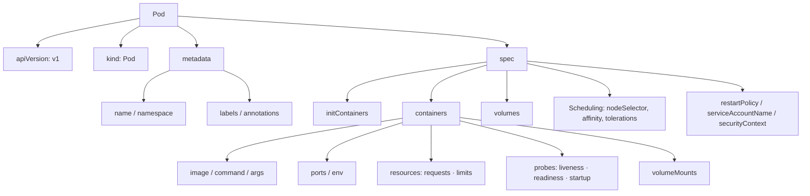

> 📎 Reference: <https://lnkd.in/gVRYM78g>

This page breaks down the Pod definition, the foundation of every Kubernetes manifest, field by field.

---

## 1. The Four Top-Level Fields

| Field | Description |
|------|------|
| `apiVersion` | The API group/version to use (`v1` for a Pod) |
| `kind` | The object type (`Pod`) |
| `metadata` | Name, namespace, labels, annotations |
| `spec` | The desired state. **The most important area** |

> `status` is filled in by the cluster, so you do not write it yourself.

---

## 2. Full Example

```yaml
apiVersion: v1
kind: Pod
metadata:
  name: web-pod
  namespace: demo
  labels:
    app: web
    tier: frontend
  annotations:
    owner: platform-team
spec:
  serviceAccountName: web-sa
  restartPolicy: Always
  nodeSelector:
    disktype: ssd
  initContainers:
  - name: init-wait
    image: busybox:1.36
    command: ["sh", "-c", "until nslookup db; do sleep 2; done"]
  containers:
  - name: nginx
    image: nginx:1.27
    imagePullPolicy: IfNotPresent
    ports:
    - containerPort: 80
    env:
    - name: APP_ENV
      value: production
    resources:
      requests:
        cpu: 100m
        memory: 128Mi
      limits:
        cpu: 500m
        memory: 256Mi
    readinessProbe:
      httpGet:
        path: /
        port: 80
    livenessProbe:
      httpGet:
        path: /
        port: 80
      initialDelaySeconds: 10
    volumeMounts:
    - name: html
      mountPath: /usr/share/nginx/html
  volumes:
  - name: html
    emptyDir: {}
```

---

## 3. The Structure at a Glance



---

## 4. Key Fields Explained

| Field | Key Point |
|------|--------|
| `labels` | What Service and Deployment selectors match on to find Pods |
| `initContainers` | Run **sequentially** before the main containers, and all must succeed before the main containers start |
| `resources.requests` | The amount the scheduler uses for placement / `limits` is the upper bound at runtime (together they determine the QoS class) |
| `readinessProbe` | On failure, the Pod is removed from the Service endpoints |
| `livenessProbe` | On failure, the container is restarted |
| `restartPolicy` | `Always` (default) / `OnFailure` / `Never` |
| `volumes` + `volumeMounts` | Volumes are declared at the Pod level, mounts at the container level |

---

## 5. Practical Tips

```bash
kubectl run web-pod --image=nginx --dry-run=client -o yaml > pod.yaml   # Generate a template
kubectl explain pod.spec.containers.resources                          # Check field documentation
kubectl apply -f pod.yaml --dry-run=server                              # Server-side validation
```

- In real operations, rather than creating Pods directly, you define the same structure inside the `template` of a **Deployment / StatefulSet**.
- If you get confused about where a field goes, `kubectl explain` is the most accurate reference.
