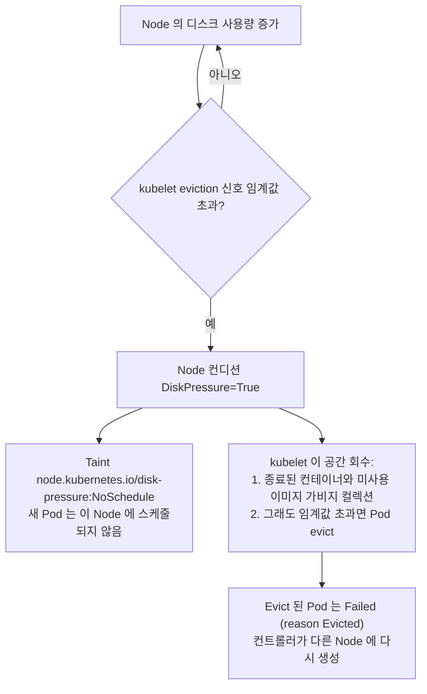

Node 의 디스크 공간이나 inode 가 부족해지면 kubelet 은 `DiskPressure` 컨디션을 설정하고, 해당 Node 에 새 Pod 스케줄링을 막은 뒤 Pod 를 evict 하기 시작합니다. 이 문서는 이를 감지하고, 디스크를 차지하는 원인을 찾아 안전하게 해결하는 방법을 다룹니다.

---

## 1. Disk Pressure 가 발생하면 일어나는 일



kubelet 은 두 개의 파일시스템을 감시합니다.

| 파일시스템 | 저장 대상 | 기본 hard eviction 임계값 (Linux) |
|------------|-----------|------------------------------------|
| `nodefs` | `/var/lib/kubelet`, Pod 로그, `emptyDir` 볼륨 | `nodefs.available < 10%`, `nodefs.inodesFree < 5%` |
| `imagefs` (분리된 경우) | 컨테이너 이미지와 쓰기 가능 레이어, 보통 `/var/lib/containerd` 아래 | `imagefs.available < 15%` |

Pod 를 evict 하기 전에 kubelet 은 **이미지 가비지 컬렉션**(사용률 85% 에서 시작, `imageGCHighThresholdPercent`, 80% 까지 정리, `imageGCLowThresholdPercent`)과 종료된 컨테이너 정리를 먼저 수행합니다.

---

## 2. 감지하기

```bash
kubectl get nodes
kubectl describe node <node> | sed -n '/Conditions/,/Addresses/p'
# DiskPressure   True   KubeletHasDiskPressure   kubelet has disk pressure

kubectl describe node <node> | grep -i taint
# Taints: node.kubernetes.io/disk-pressure:NoSchedule

kubectl get events -A --field-selector reason=Evicted
kubectl get pods -A --field-selector=status.phase=Failed      # evict 된 Pod
```

---

## 3. 디스크를 차지하는 대상 찾기

Node 에서 실행합니다.

```bash
df -h /var/lib/kubelet /var/lib/containerd /var/log
df -i /var/lib/kubelet                    # inode 고갈도 디스크 가득 참으로 나타남

du -xh /var/lib --max-depth=2 2>/dev/null | sort -rh | head -15
du -sh /var/log/pods /var/log/containers  # 컨테이너 로그

crictl images                              # 이미지 크기
crictl ps -a                               # 레이어를 붙잡고 있는 종료된 컨테이너
```

Pod 별 ephemeral storage 사용량 (kubelet summary API):

```bash
kubectl get --raw "/api/v1/nodes/<node>/proxy/stats/summary" \
  | jq -r '.pods[] | [.podRef.namespace, .podRef.name, .["ephemeral-storage"].usedBytes] | @tsv' \
  | sort -k3 -nr | head
```

---

## 4. 주요 원인과 해결

| 원인 | 확인 방법 | 해결 |
|------|-----------|------|
| **미사용 이미지 누적** | `crictl images` 에 오래된 태그가 많음 | `crictl rmi --prune` (어떤 컨테이너도 쓰지 않는 이미지 삭제) |
| **컨테이너 로그가 제한 없이 증가** | `/var/log/pods` 아래 큰 파일 | kubelet 로그 로테이션 설정: `containerLogMaxSize`(기본 10Mi), `containerLogMaxFiles`(기본 5), 로그는 Node 밖으로 수집 |
| **Pod 가 `emptyDir` 또는 컨테이너 레이어에 많이 기록** | summary API 에서 해당 Pod 의 `ephemeral-storage` 가 큼 | `resources.limits.ephemeral-storage` 를 설정해 문제 Pod 만 evict 되게 하거나, 데이터를 PersistentVolume 으로 이동 |
| **종료된 컨테이너와 오래된 Pod sandbox** | `crictl ps -a` 에 종료된 컨테이너가 많음 | 보통 kubelet 의 컨테이너 가비지 컬렉션이 제거함. 멈춘 경우 `crictl rm <id>` 로 특정 컨테이너를 제거하거나 점검 시간에 런타임 재시작 |
| **Inode 고갈** | `df -i` 가 100% | 작은 파일이 수백만 개인 디렉터리 탐색 (`find /var/lib -xdev -type f \| cut -d/ -f1-5 \| sort \| uniq -c \| sort -rn \| head`) |
| **디스크 자체가 작음** | 사용량이 정상 범위 | 볼륨 확장, 또는 `/var/lib/containerd`, `/var/lib/kubelet` 을 더 큰 디스크로 이동 |
| **Kubernetes 외부 호스트 프로세스** | `/var/log/journal`, `/tmp`, 코어 덤프가 공간 차지 | `journalctl --vacuum-size=500M`, 파일 정리, 로그 로테이션 추가 |

이후 evict 된 Pod 오브젝트를 정리합니다. 기록일 뿐이지만 API 를 어지럽힙니다.

```bash
kubectl delete pods -A --field-selector=status.phase=Failed
```

---

## 5. 튜닝과 예방

```yaml
# KubeletConfiguration (예시)
evictionHard:
  nodefs.available: "10%"
  imagefs.available: "15%"
evictionSoft:
  nodefs.available: "15%"
evictionSoftGracePeriod:
  nodefs.available: "2m"
imageGCHighThresholdPercent: 80
imageGCLowThresholdPercent: 70
containerLogMaxSize: "20Mi"
containerLogMaxFiles: 3
```

- 모든 워크로드에 `ephemeral-storage` requests 와 limits 를 지정해 Pod 하나가 Node 디스크를 독점하지 못하게 합니다.
- kubelet 이 조치하기 전에 알림을 받도록 `node_filesystem_avail_bytes`, `kubelet_evictions` 메트릭 등에 경보를 설정합니다.
- 가능하면 `/var/lib/containerd` 는 전용 디스크를 사용합니다.

> 공간을 확보하면 kubelet 이 약 1분 안에 `DiskPressure` 를 스스로 해제하고 taint 도 자동으로 제거됩니다. Node 를 cordon 한 적이 없으므로 `kubectl uncordon` 은 필요하지 않습니다.
