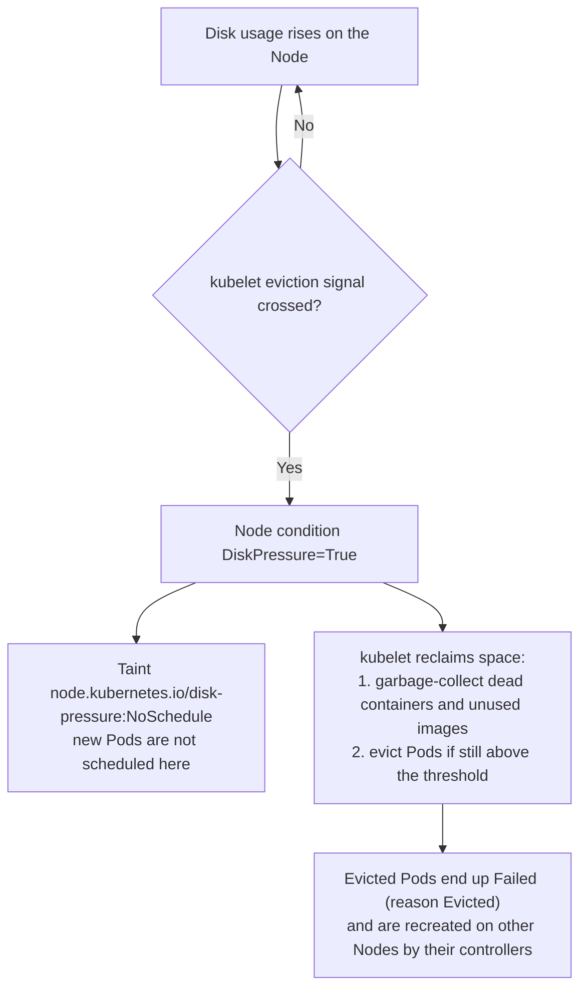

When a Node runs low on disk space or inodes, the kubelet sets the `DiskPressure` condition, stops scheduling new Pods there, and starts evicting Pods. This page covers how to detect it, find what is eating the disk, and fix it safely.

---

## 1. What Happens Under Disk Pressure



The kubelet watches two filesystems:

| Filesystem | Holds | Default hard eviction threshold (Linux) |
|------------|-------|------------------------------------------|
| `nodefs` | `/var/lib/kubelet`, Pod logs, `emptyDir` volumes | `nodefs.available < 10%`, `nodefs.inodesFree < 5%` |
| `imagefs` (if separate) | Container images and writable container layers, usually under `/var/lib/containerd` | `imagefs.available < 15%` |

Before evicting Pods, the kubelet runs **image garbage collection** (starts at 85% usage, `imageGCHighThresholdPercent`, and frees down to 80%, `imageGCLowThresholdPercent`) and cleans up dead containers.

---

## 2. Detect It

```bash
kubectl get nodes
kubectl describe node <node> | sed -n '/Conditions/,/Addresses/p'
# DiskPressure   True   KubeletHasDiskPressure   kubelet has disk pressure

kubectl describe node <node> | grep -i taint
# Taints: node.kubernetes.io/disk-pressure:NoSchedule

kubectl get events -A --field-selector reason=Evicted
kubectl get pods -A --field-selector=status.phase=Failed      # evicted Pods
```

---

## 3. Find What Is Using the Disk

On the Node:

```bash
df -h /var/lib/kubelet /var/lib/containerd /var/log
df -i /var/lib/kubelet                    # inode exhaustion looks like a full disk

du -xh /var/lib --max-depth=2 2>/dev/null | sort -rh | head -15
du -sh /var/log/pods /var/log/containers  # container logs

crictl images                              # image sizes
crictl ps -a                               # exited containers still holding layers
```

Per-Pod ephemeral storage usage (from the kubelet summary API):

```bash
kubectl get --raw "/api/v1/nodes/<node>/proxy/stats/summary" \
  | jq -r '.pods[] | [.podRef.namespace, .podRef.name, .["ephemeral-storage"].usedBytes] | @tsv' \
  | sort -k3 -nr | head
```

---

## 4. Common Causes and Fixes

| Cause | How to recognize it | Fix |
|-------|--------------------|-----|
| **Unused images pile up** | `crictl images` shows many old tags | `crictl rmi --prune` (removes images no container uses) |
| **Container logs grow without limit** | Large files under `/var/log/pods` | Configure kubelet log rotation: `containerLogMaxSize` (default 10Mi) and `containerLogMaxFiles` (default 5); ship logs off the Node |
| **Pods write a lot to `emptyDir` or the container layer** | The summary API shows large `ephemeral-storage` for a Pod | Set `resources.limits.ephemeral-storage` so the kubelet evicts the offending Pod, or move data to a PersistentVolume |
| **Dead containers and old Pod sandboxes** | Many exited containers in `crictl ps -a` | Normally the kubelet's container garbage collection removes them; if it is stuck, remove the specific exited containers with `crictl rm <id>`, or restart the runtime during a maintenance window |
| **Inode exhaustion** | `df -i` at 100% | Find directories with millions of tiny files (`find /var/lib -xdev -type f \| cut -d/ -f1-5 \| sort \| uniq -c \| sort -rn \| head`) |
| **Disk is simply too small** | Usage is legitimate | Expand the volume, or put `/var/lib/containerd` and `/var/lib/kubelet` on a larger disk |
| **Host processes outside Kubernetes** | `du` shows space in `/var/log/journal`, `/tmp`, core dumps | `journalctl --vacuum-size=500M`, clean the files, add log rotation |

Clean up the evicted Pod objects afterwards (they are only records, but they clutter the API):

```bash
kubectl delete pods -A --field-selector=status.phase=Failed
```

---

## 5. Tune and Prevent

```yaml
# KubeletConfiguration (example)
evictionHard:
  nodefs.available: "10%"
  imagefs.available: "15%"
evictionSoft:
  nodefs.available: "15%"
evictionSoftGracePeriod:
  nodefs.available: "2m"
imageGCHighThresholdPercent: 80
imageGCLowThresholdPercent: 70
containerLogMaxSize: "20Mi"
containerLogMaxFiles: 3
```

- Give every workload an `ephemeral-storage` request and limit, so a single Pod cannot consume the Node's disk.
- Alert before the kubelet has to act, for example on `node_filesystem_avail_bytes` and `kubelet_evictions` metrics.
- Use a dedicated disk for `/var/lib/containerd` where possible.

> After space is freed, the kubelet clears `DiskPressure` on its own within about a minute, and the taint is removed automatically. No `kubectl uncordon` is needed because the Node was never cordoned.
