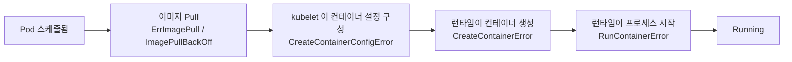

`CreateContainerError` 는 Pod 가 스케줄되고 이미지도 받았지만 **컨테이너 런타임이 컨테이너를 생성하지 못했다**는 뜻입니다. 비슷해 보이는 상태가 세 가지 있으며, 라이프사이클 단계로 구분하는 것이 가장 빠른 트러블슈팅 방법입니다.

---

## 1. 각 오류가 발생하는 단계



| 상태 (`kubectl get pod`) | 실패한 단계 | 일반적인 의미 |
|--------------------------|-------------|---------------|
| `CreateContainerConfigError` | 런타임 호출 이전, kubelet | 참조한 ConfigMap/Secret/키가 없거나 보안 설정이 잘못됨 (Use Case 10) |
| **`CreateContainerError`** | 런타임 `CreateContainer` 호출 | 런타임이 컨테이너를 생성하지 못함 (이 문서) |
| `RunContainerError` | 런타임 `StartContainer` 호출 | 컨테이너는 생성됐지만 프로세스를 시작하지 못함 (Use Case 11) |

---

## 2. 진단

```bash
kubectl get pod <pod>
kubectl describe pod <pod>                 # Events 와 컨테이너의 State/Message 확인
kubectl get pod <pod> -o jsonpath='{.status.containerStatuses[*].state}'
```

이벤트 메시지가 모호하면 Node 에서 확인합니다.

```bash
journalctl -u kubelet -n 100 --no-pager
journalctl -u containerd -n 100 --no-pager
crictl ps -a | grep <pod>
```

Events 의 `Error:` 뒤에 나오는 문구가 실제 단서입니다. 자주 보는 메시지는 다음과 같습니다.

| 메시지 (일부) | 원인 | 해결 |
|---------------|------|------|
| `no command specified` | 이미지에 `ENTRYPOINT`/`CMD` 가 없고 Pod 도 `command`/`args` 를 지정하지 않음 | Pod spec 에 `command`/`args` 를 지정하거나 이미지를 수정 |
| `failed to reserve container name ... is reserved for ...` | 같은 이름의 이전 시도가 런타임에 남아 있음 (런타임이나 kubelet 재시작 후 흔함) | kubelet 재시도를 기다리거나, Pod 를 삭제해 새로 만들거나, 점검 시간에 containerd 재시작 |
| 마운트나 경로 정보가 포함된 `failed to create containerd container: ...` | 잘못된 볼륨 마운트나 `subPath` (이미지에서는 디렉터리인 위치에 파일을 마운트하는 경우 등) | `volumeMounts`/`subPath` 수정, 이미지 내부 경로 확인 |
| `... too many open files` / `no space left on device` | 런타임 쪽 Node 리소스 고갈 | 디스크 확보 또는 제한 상향 (Use Case 8) |
| `failed to generate container ... spec: ...` | Pod 설정에서 OCI spec 을 만들지 못함 (잘못된 `securityContext`, 사용자, 디바이스 등) | 문제가 된 Pod 필드 수정 |

---

## 3. 해결 체크리스트

1. `kubectl describe pod` 로 정확한 오류 문구를 복사합니다.
2. 컨테이너의 `command`/`args` 를 이미지의 `ENTRYPOINT`/`CMD` 와 비교합니다.
   ```bash
   crictl inspecti <image> | jq '.info.imageSpec.config | {Entrypoint, Cmd}'
   ```
3. 모든 `volumeMounts` 항목을 `volumes` 항목과 대조합니다. 특히 `subPath` 를 확인합니다.
4. 같은 명령으로 이미지를 로컬에서 실행해 이미지 문제와 클러스터 문제를 구분합니다.
   ```bash
   docker run --rm -it --entrypoint sh <image>
   ```
5. 메시지가 런타임 자체(이름 예약, shim, task)를 언급하면 해당 Node 의 containerd 와 kubelet 로그를 확인한 뒤 Pod 를 재생성합니다.

```bash
kubectl delete pod <pod>      # Deployment 가 관리하는 Pod 는 새 Pod 가 자동으로 생성됨
```

> `CreateContainerError` 는 kubelet 이 백오프를 두고 재시도합니다. 근본 원인을 해결하면(예: 누락된 마운트 소스를 만들면) 수동 조치 없이 Pod 가 복구됩니다.
