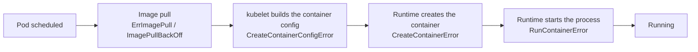

`CreateContainerError` means the Pod was scheduled and the image was pulled, but the **container runtime failed to create the container**. Three look-alike statuses exist, and telling them apart by lifecycle stage is the fastest way to troubleshoot.

---

## 1. Where Each Error Occurs



| Status (`kubectl get pod`) | Stage that failed | Typical meaning |
|----------------------------|-------------------|-----------------|
| `CreateContainerConfigError` | kubelet, before calling the runtime | A referenced ConfigMap/Secret/key is missing, or the security settings are invalid (see Use Case 10) |
| **`CreateContainerError`** | Runtime `CreateContainer` call | The runtime could not create the container (this page) |
| `RunContainerError` | Runtime `StartContainer` call | The container was created but its process could not start (see Use Case 11) |

---

## 2. Diagnose

```bash
kubectl get pod <pod>
kubectl describe pod <pod>                 # read Events and the container's State/Message
kubectl get pod <pod> -o jsonpath='{.status.containerStatuses[*].state}'
```

On the Node, when the event message is vague:

```bash
journalctl -u kubelet -n 100 --no-pager
journalctl -u containerd -n 100 --no-pager
crictl ps -a | grep <pod>
```

The text after `Error:` in the Events is the real clue. Common messages:

| Message (excerpt) | Cause | Fix |
|-------------------|-------|-----|
| `no command specified` | The image has no `ENTRYPOINT`/`CMD` and the Pod sets neither `command` nor `args` | Set `command`/`args` in the Pod spec, or fix the image |
| `failed to reserve container name ... is reserved for ...` | A previous attempt with the same name still exists in the runtime, often after a runtime or kubelet restart | Wait for the kubelet to retry, delete the Pod so a new one is created, or restart containerd during maintenance |
| `failed to create containerd container: ...` with a mount or path detail | Invalid volume mount or `subPath` (for example mounting a file where the image has a directory) | Fix `volumeMounts`/`subPath`; verify the path inside the image |
| `... too many open files` / `no space left on device` | Node resource exhaustion in the runtime | Free disk or raise limits (see Use Case 8) |
| `failed to generate container ... spec: ...` | Runtime cannot build the OCI spec from the Pod settings (for example invalid `securityContext`, user, or device) | Correct the offending Pod field |

---

## 3. Fix Checklist

1. Run `kubectl describe pod` and copy the exact error text.
2. Compare the container's `command`/`args` with the image's `ENTRYPOINT`/`CMD`.
   ```bash
   crictl inspecti <image> | jq '.info.imageSpec.config | {Entrypoint, Cmd}'
   ```
3. Validate every `volumeMounts` entry against its `volumes` entry, especially `subPath`.
4. Test the image locally with the same command to separate image problems from cluster problems:
   ```bash
   docker run --rm -it --entrypoint sh <image>
   ```
5. If the message mentions the runtime itself (name reservation, shim, task), check containerd and kubelet logs on that Node, then recreate the Pod.

```bash
kubectl delete pod <pod>      # for a Deployment-managed Pod, a fresh Pod is created automatically
```

> `CreateContainerError` is retried by the kubelet with back-off. If the root cause is fixed (for example by creating a missing mount source), the Pod recovers without manual intervention.
