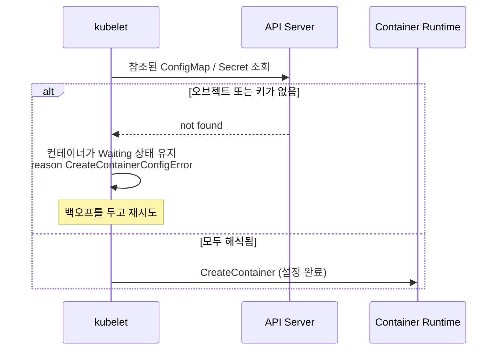

`CreateContainerConfigError` 는 kubelet 이 런타임에 컨테이너 생성을 요청하기도 전에 **컨테이너 설정을 구성하지 못할 때** 나타납니다. 실제로는 거의 항상 ConfigMap 이나 Secret(또는 그 안의 키)이 없거나, 보안 설정이 잘못된 경우입니다.

---

## 1. 발생 지점



---

## 2. 진단

```bash
kubectl get pod <pod>
# NAME   READY   STATUS                       RESTARTS   AGE
# web    0/1     CreateContainerConfigError   0          2m

kubectl describe pod <pod> | sed -n '/Events/,$p'
kubectl get pod <pod> -o jsonpath='{.status.containerStatuses[*].state.waiting.message}'
```

자주 보는 메시지:

| 메시지 | 원인 |
|--------|------|
| `configmap "app-config" not found` | Pod 의 Namespace 에 ConfigMap 이 없음 |
| `secret "db-secret" not found` | Pod 의 Namespace 에 Secret 이 없음 |
| `couldn't find key DB_HOST in ConfigMap default/app-config` | 오브젝트는 있지만 참조한 키가 없음 (오타나 대소문자 차이 포함) |
| `container has runAsNonRoot and image will run as root` | `securityContext.runAsNonRoot: true` 인데 이미지가 root 로 실행됨 |
| `container has runAsNonRoot and image has non-numeric user (appuser), cannot verify user is non-root` | 이미지가 이름 기반 `USER` 를 사용해 root 가 아님을 검증할 수 없음 |

---

## 3. 원인별 해결

### ConfigMap 또는 Secret 없음

```bash
kubectl get configmap,secret -n <namespace>
kubectl get pod <pod> -o yaml | grep -n -B2 -A6 -E "configMapKeyRef|secretKeyRef|configMap:|secret:"
```

Pod 와 **같은 Namespace** 에 오브젝트를 만들거나 매니페스트의 이름을 고칩니다.

```bash
kubectl create configmap app-config --from-literal=DB_HOST=db.default.svc -n <namespace>
```

kubelet 이 자동으로 재시도하므로 오브젝트가 생기면 컨테이너가 시작됩니다. Pod 를 다시 만들 필요는 없습니다.

### 키 없음

```yaml
env:
- name: DB_HOST
  valueFrom:
    configMapKeyRef:
      name: app-config
      key: DB_HOST        # ConfigMap 의 키와 정확히 일치해야 함 (대소문자 구분)
      optional: false     # true 면 변수 없이도 컨테이너가 시작됨
```

`optional: true` 는 애플리케이션이 해당 값 없이도 정상 동작할 때만 사용하세요.

### `runAsNonRoot` 문제

Kubernetes 가 검증할 수 있도록 숫자 UID 를 지정합니다.

```yaml
securityContext:
  runAsNonRoot: true
  runAsUser: 10001
```

또는 이미지를 숫자 `USER 10001` 로 빌드합니다.

---

## 4. 예방

- ConfigMap 과 Secret 을 이를 사용하는 워크로드보다 **먼저**(또는 같은 릴리스에서) 배포합니다. Helm 에서는 같은 차트에 넣고, 일반 매니페스트에서는 먼저 apply 합니다.
- 적용 전에 검증합니다.
  ```bash
  kubectl apply -f deploy.yaml --dry-run=server
  ```
  서버 측 dry-run 은 참조된 ConfigMap 의 존재 여부를 확인하지 않으므로, CI 에서 `kubectl get configmap <name>` 도 함께 실행하세요.
- `envFrom`/`env` 값은 컨테이너 생성 시점에 읽힌다는 점을 기억하세요. 나중에 ConfigMap 을 바꿔도 실행 중인 컨테이너의 환경 변수는 갱신되지 않습니다 (볼륨으로 마운트한 ConfigMap 은 결국 갱신됩니다).
