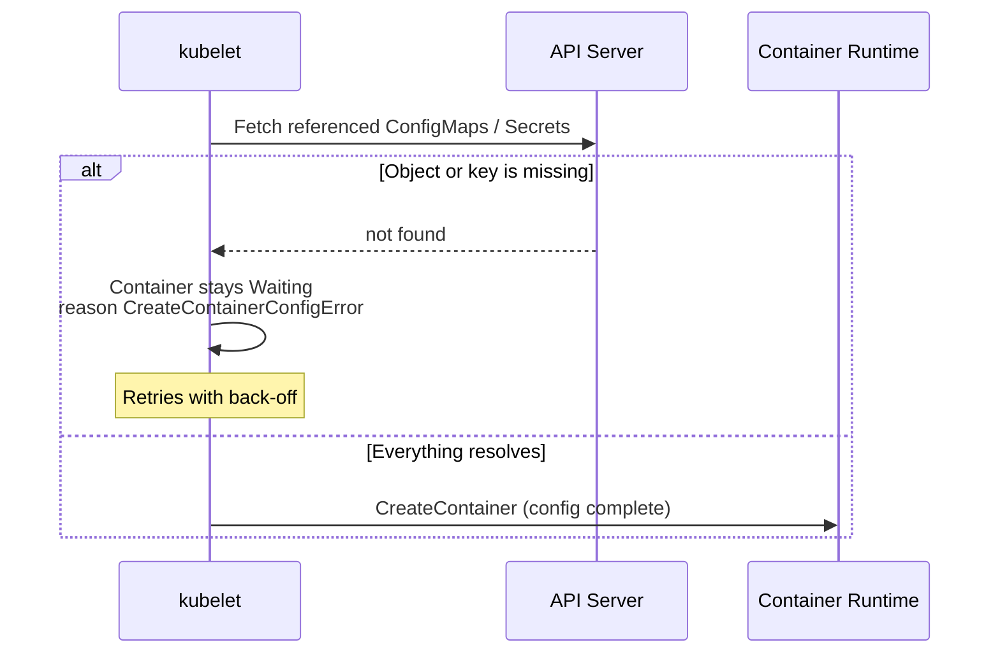

`CreateContainerConfigError` appears when the **kubelet cannot assemble the container configuration** before it even asks the runtime to create the container. In practice this is almost always a missing ConfigMap or Secret (or a missing key in one), or an invalid security setting.

---

## 1. Where It Happens



---

## 2. Diagnose

```bash
kubectl get pod <pod>
# NAME   READY   STATUS                       RESTARTS   AGE
# web    0/1     CreateContainerConfigError   0          2m

kubectl describe pod <pod> | sed -n '/Events/,$p'
kubectl get pod <pod> -o jsonpath='{.status.containerStatuses[*].state.waiting.message}'
```

Typical messages:

| Message | Cause |
|---------|-------|
| `configmap "app-config" not found` | The ConfigMap does not exist in the Pod's Namespace |
| `secret "db-secret" not found` | The Secret does not exist in the Pod's Namespace |
| `couldn't find key DB_HOST in ConfigMap default/app-config` | The object exists but the referenced key does not (or its name has a typo/case difference) |
| `container has runAsNonRoot and image will run as root` | `securityContext.runAsNonRoot: true` but the image runs as root |
| `container has runAsNonRoot and image has non-numeric user (appuser), cannot verify user is non-root` | The image uses a named `USER`; Kubernetes cannot verify it is non-root |

---

## 3. Fixes by Cause

### Missing ConfigMap or Secret

```bash
kubectl get configmap,secret -n <namespace>
kubectl get pod <pod> -o yaml | grep -n -B2 -A6 -E "configMapKeyRef|secretKeyRef|configMap:|secret:"
```

Create the object in the **same Namespace** as the Pod, or fix the name in the manifest:

```bash
kubectl create configmap app-config --from-literal=DB_HOST=db.default.svc -n <namespace>
```

The kubelet retries automatically, so the container starts once the object exists. You do not need to recreate the Pod.

### Missing key

```yaml
env:
- name: DB_HOST
  valueFrom:
    configMapKeyRef:
      name: app-config
      key: DB_HOST        # must match a key in the ConfigMap exactly (case-sensitive)
      optional: false     # true lets the container start without the variable
```

Use `optional: true` only when the application really tolerates the value being absent.

### `runAsNonRoot` problems

Specify a numeric UID so Kubernetes can verify it:

```yaml
securityContext:
  runAsNonRoot: true
  runAsUser: 10001
```

or build the image with a numeric `USER 10001`.

---

## 4. Prevention

- Deploy ConfigMaps and Secrets **before** (or in the same release as) the workloads that use them. With Helm, put them in the same chart; with plain manifests, apply them first.
- Validate before applying:
  ```bash
  kubectl apply -f deploy.yaml --dry-run=server
  ```
  Server-side dry-run does not check that referenced ConfigMaps exist, so also run `kubectl get configmap <name>` in CI.
- Remember that `envFrom`/`env` values are read when the container is created: changing a ConfigMap later does not update the environment of running containers (volume-mounted ConfigMaps do update eventually).
