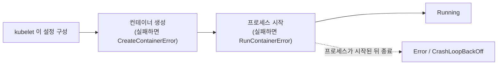
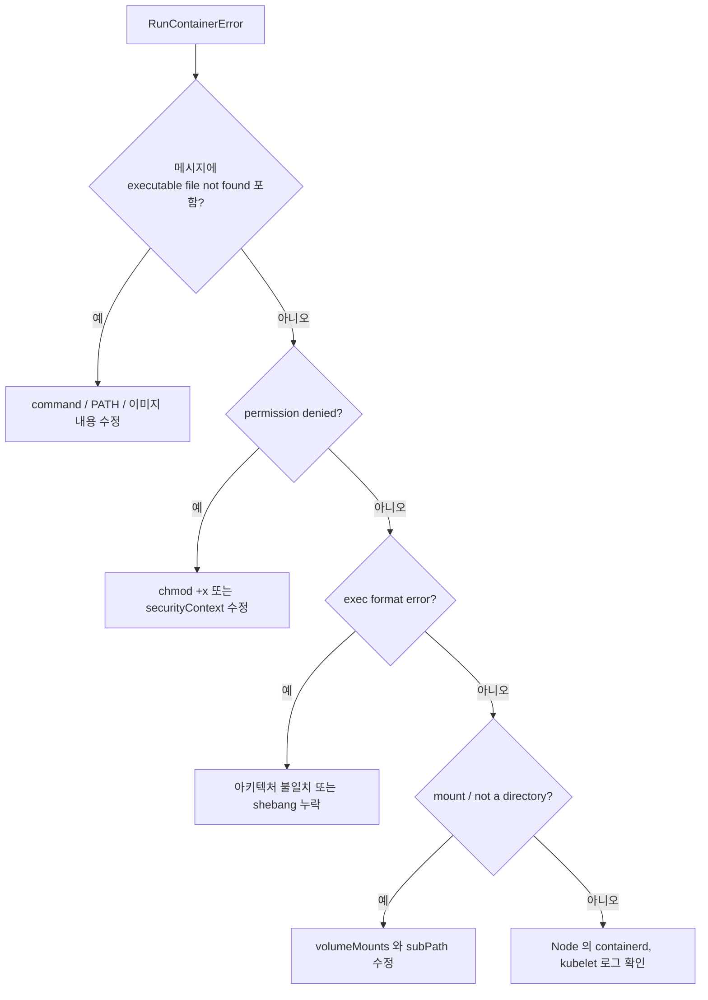

`RunContainerError` 는 런타임이 **컨테이너는 생성했지만 프로세스를 시작하지 못했다**는 뜻입니다. 문제는 컨테이너가 실행하도록 지시받은 대상(엔트리포인트, 권한, 바이너리 형식, 마운트)에 있으므로 해결책은 보통 이미지나 Pod 의 `command` 에 있습니다.

---

## 1. 컨테이너 라이프사이클에서의 위치



프로세스가 시작된 뒤 종료되면 `Error` 와 결국 `CrashLoopBackOff` 가 보이고 `kubectl logs` 에 출력이 남습니다. `RunContainerError` 는 프로세스가 한 번도 실행되지 않았으므로 보통 **애플리케이션 로그가 없습니다**.

---

## 2. 진단

```bash
kubectl describe pod <pod>
kubectl get pod <pod> -o jsonpath='{.status.containerStatuses[*].lastState}'
kubectl logs <pod> --previous       # 이 오류에서는 보통 비어 있음
```

자주 보는 메시지 (`OCI runtime create failed` 나 `StartError` 가 포함되는 경우가 많음):

| 메시지 (일부) | 원인 | 해결 |
|---------------|------|------|
| `exec: "myapp": executable file not found in $PATH` | `command` 가 이미지에 없거나 `PATH` 에 없는 바이너리를 가리킴 | 전체 경로(`/usr/local/bin/myapp`) 사용 또는 이미지 수정 |
| `exec: "./start.sh": permission denied` | 스크립트나 바이너리에 실행 권한이 없음 | Dockerfile 에서 `chmod +x` (`RUN chmod +x /start.sh`) |
| `exec format error` | 바이너리가 다른 CPU 아키텍처용이거나 셸 스크립트에 `#!` 줄이 없음 | 멀티 아키텍처 이미지 빌드(Use Case 4)와 올바른 shebang 추가 |
| 존재하는 스크립트인데 `no such file or directory` | shebang 줄의 Windows(CRLF) 줄바꿈, 또는 shebang 이 가리키는 인터프리터 부재 (Alpine 과 `bash` 에서 흔함) | LF 로 변환(`dos2unix`), 인터프리터 설치 또는 `sh` 사용 |
| `error mounting ... not a directory` / `mount ... to rootfs ... caused: not a directory` | 디렉터리에 파일을 마운트(또는 그 반대), 주로 `subPath` 와 함께 발생 | 마운트 경로와 `subPath` 수정 |
| `operation not permitted` / seccomp, capability 오류 | `securityContext`, seccomp, AppArmor, SELinux 설정이 프로세스를 차단 | 보안 설정을 완화하거나 올바르게 수정 |
| `failed to start shim` / `OCI runtime create failed: ... cgroup` | 런타임 또는 Node 수준 문제 | 해당 Node 의 containerd/runc 버전과 로그 확인 |

---

## 3. 재현과 원인 분리

먼저 Kubernetes 밖에서 같은 명령을 실행해 봅니다.

```bash
docker run --rm -it <image> <command> <args>
docker run --rm -it --entrypoint sh <image>     # 셸로 들어가 파일시스템 확인
```

클러스터 안에서는 실패하는 명령 대신 셸로 같은 이미지를 시작합니다.

```bash
kubectl run debug --rm -it --image=<image> --command -- sh
which myapp; ls -l /usr/local/bin/myapp; head -1 /start.sh | od -c | head
```

Node 에서는 런타임 로그에 정확한 실패 원인이 나오는 경우가 많습니다.

```bash
journalctl -u containerd -n 100 --no-pager
crictl ps -a | grep <pod>
```

---

## 4. 빠른 판단 가이드



> 매니페스트를 고치면 Deployment 는 다음 롤아웃에서 Pod 를 자동으로 교체합니다. 단독 Pod 는 삭제 후 다시 만드세요.
