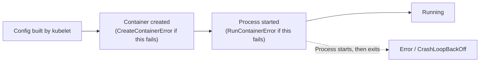
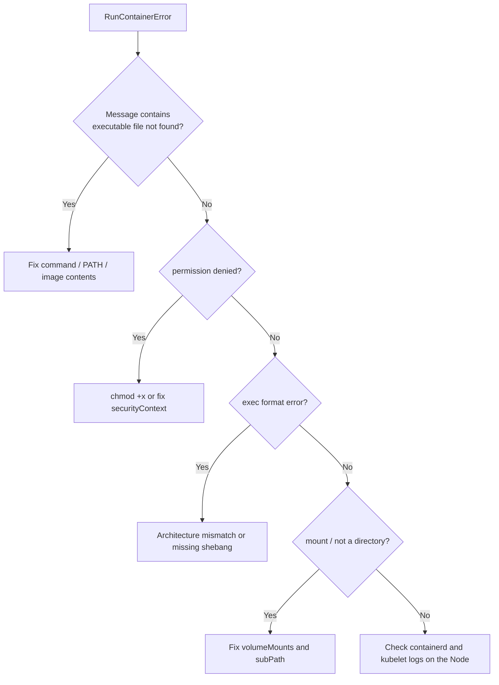

`RunContainerError` means the runtime **created the container but could not start its process**. The problem lies in what the container is asked to run (entrypoint, permissions, binary format, mounts), so the fix is usually in the image or the Pod's `command`.

---

## 1. Position in the Container Lifecycle



If the process starts and then exits, you see `Error` and eventually `CrashLoopBackOff`, and `kubectl logs` shows output. With `RunContainerError` the process never ran, so there are normally **no application logs**.

---

## 2. Diagnose

```bash
kubectl describe pod <pod>
kubectl get pod <pod> -o jsonpath='{.status.containerStatuses[*].lastState}'
kubectl logs <pod> --previous       # usually empty for this error
```

Typical messages (they often include `OCI runtime create failed` or `StartError`):

| Message (excerpt) | Cause | Fix |
|-------------------|-------|-----|
| `exec: "myapp": executable file not found in $PATH` | `command` names a binary that does not exist in the image or is not on `PATH` | Use the full path (`/usr/local/bin/myapp`), or correct the image |
| `exec: "./start.sh": permission denied` | The script or binary is not executable | `chmod +x` in the Dockerfile (`RUN chmod +x /start.sh`) |
| `exec format error` | The binary targets a different CPU architecture, or a shell script is missing its `#!` line | Build a multi-architecture image (see Use Case 4) and add a proper shebang |
| `no such file or directory` for an existing script | Windows (CRLF) line endings in the shebang line, or the interpreter named in the shebang is missing (common with Alpine and `bash`) | Convert to LF (`dos2unix`), install the interpreter, or use `sh` |
| `error mounting ... not a directory` / `mount ... to rootfs ... caused: not a directory` | A file is mounted onto a directory (or the reverse), often with `subPath` | Fix the mount path and `subPath` |
| `operation not permitted` / seccomp or capability errors | `securityContext`, seccomp, AppArmor, or SELinux settings block the process | Relax or correct the security settings |
| `failed to start shim` / `OCI runtime create failed: ... cgroup` | A runtime or Node-level problem | Check containerd/runc versions and logs on that Node |

---

## 3. Reproduce and Isolate

Run the exact command outside Kubernetes first:

```bash
docker run --rm -it <image> <command> <args>
docker run --rm -it --entrypoint sh <image>     # open a shell and inspect the filesystem
```

Inside the cluster, start the same image with a shell instead of the failing command:

```bash
kubectl run debug --rm -it --image=<image> --command -- sh
which myapp; ls -l /usr/local/bin/myapp; head -1 /start.sh | od -c | head
```

On the Node, the runtime logs often show the precise failure:

```bash
journalctl -u containerd -n 100 --no-pager
crictl ps -a | grep <pod>
```

---

## 4. Quick Decision Guide



> After you fix the manifest, a Deployment replaces the Pods automatically on the next rollout. For a standalone Pod, delete and recreate it.
