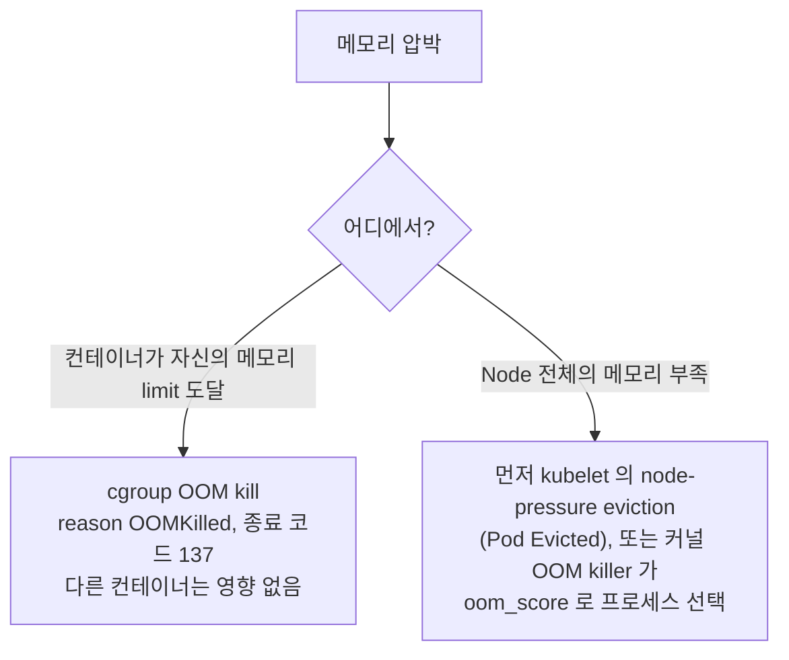

`OOMKilled` 는 컨테이너가 **허용된 메모리보다 많이 사용해서** 종료되었다는 뜻입니다. 리눅스 커널의 OOM(Out-Of-Memory) killer 가 `SIGKILL` 로 프로세스를 종료하고, 컨테이너는 종료 코드 **137**(128 + 9)로 끝납니다.

---

## 1. 서로 다른 두 종류의 OOM



| | 컨테이너 limit OOM | Node 수준 메모리 압박 |
|---|---|---|
| 트리거 | 사용량이 `resources.limits.memory` 초과 | Node 의 `memory.available` 이 eviction 임계값 미만 |
| 확인되는 모습 | `lastState.terminated.reason: OOMKilled` | Pod `Evicted`(kubelet), 커널이 먼저 동작하면 `OOMKilled` |
| 영향 범위 | 해당 컨테이너만 | QoS 클래스와 requests 초과 사용량으로 선택된 Pod (BestEffort, Burstable 우선) |

---

## 2. OOM Kill 이었는지 확인

```bash
kubectl get pod <pod>
# STATUS   OOMKilled  (또는 재시작이 늘어나는 CrashLoopBackOff)

kubectl describe pod <pod> | sed -n '/Last State/,/Ready/p'
#   Last State:  Terminated
#     Reason:    OOMKilled
#     Exit Code: 137

kubectl get pod <pod> -o jsonpath='{.status.containerStatuses[*].lastState.terminated.reason}'
```

종료 코드 137 은 `SIGKILL` 만 증명합니다. `OOMKilled` reason 이나 Node 에서 확인하세요.

```bash
dmesg -T | grep -i -E "out of memory|oom-kill|killed process"
journalctl -k | grep -i oom
```

실제 사용량을 limit 과 비교합니다 (metrics-server 필요).

```bash
kubectl top pod <pod> --containers
kubectl get pod <pod> -o jsonpath='{.spec.containers[*].resources}'
```

---

## 3. 원인과 해결

| 원인 | 해결 |
|------|------|
| 실제 워크로드에 비해 **limit 이 너무 낮음** | 피크 사용량을 측정한 뒤 여유를 두고 `limits.memory` 상향 |
| 애플리케이션의 **메모리 누수** | 프로파일링 후 수정, 재시작은 임시방편으로만 사용 |
| **런타임이 컨테이너 limit 을 무시** (예: Node 메모리 기준으로 크기를 잡는 JVM) | 런타임을 컨테이너 인식형으로 설정: JVM `-XX:MaxRAMPercentage=75`, Go `GOMEMLIMIT`, Node.js `--max-old-space-size` |
| **`emptyDir` 의 `medium: Memory`** 또는 `tmpfs` 파일 | tmpfs 데이터는 컨테이너 메모리로 계산되므로 줄이거나 디스크 기반 스토리지 사용 |
| **트래픽 또는 배치 급증** | 레플리카 추가 또는 오토스케일링(HPA), 동시성과 배치 크기 제한 |
| **Node 오버커밋** (limits 가 requests 보다 훨씬 큼) | `requests` 를 실제 사용량에 가깝게, 중요한 Pod 는 `requests = limits` |

```yaml
resources:
  requests:
    memory: 512Mi
  limits:
    memory: 1Gi       # 모든 리소스에서 requests == limits 이면 QoS 클래스는 Guaranteed
```

> Node 압박 상황에서는 QoS 가 중요합니다. **Guaranteed** Pod(CPU, 메모리의 requests 와 limits 가 같음)가 가장 마지막에 evict 되고, **BestEffort**(requests, limits 없음)가 가장 먼저 evict 됩니다.

---

## 4. 적정 크기 산정과 예방

- 관찰된 데이터로 limit 을 정합니다. 예를 들어 대표 기간의 `container_memory_working_set_bytes` 피크에 20~30% 여유를 더합니다. kubelet 과 OOM killer 가 보는 값은 전체 캐시가 아니라 working set 입니다.
- Vertical Pod Autoscaler 를 추천(recommendation) 모드로 두면 requests 와 limits 를 제안받을 수 있습니다.
- `kube_pod_container_status_last_terminated_reason{reason="OOMKilled"}` 와 limit 의 약 85% 를 넘는 사용량에 경보를 설정합니다.
- limit 을 올려도 Node 에 메모리가 있어야 효과가 있습니다. `kubectl describe node` 로 allocatable 메모리와 현재 requests 를 확인하세요.
