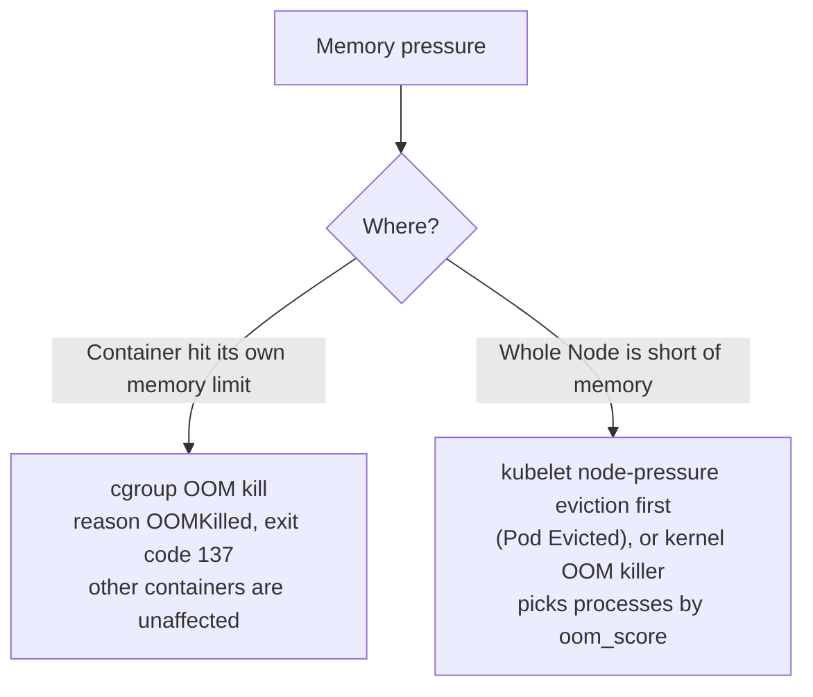

`OOMKilled` means a container was killed because it **used more memory than it was allowed**. The Linux kernel's out-of-memory (OOM) killer terminates the process with `SIGKILL`, and the container exits with code **137** (128 + 9).

---

## 1. Two Different Kinds of OOM



| | Container limit OOM | Node-level memory pressure |
|---|---|---|
| Trigger | Usage exceeds `resources.limits.memory` | Node `memory.available` falls below the eviction threshold |
| Visible as | `lastState.terminated.reason: OOMKilled` | Pod `Evicted` (kubelet), or `OOMKilled` if the kernel acts first |
| Who is affected | Only that container | Pods chosen by QoS class and usage over requests (BestEffort and Burstable first) |

---

## 2. Confirm It Was an OOM Kill

```bash
kubectl get pod <pod>
# STATUS   OOMKilled  (or CrashLoopBackOff with restarts increasing)

kubectl describe pod <pod> | sed -n '/Last State/,/Ready/p'
#   Last State:  Terminated
#     Reason:    OOMKilled
#     Exit Code: 137

kubectl get pod <pod> -o jsonpath='{.status.containerStatuses[*].lastState.terminated.reason}'
```

Exit code 137 alone only proves `SIGKILL`. Confirm with the `OOMKilled` reason, or on the Node:

```bash
dmesg -T | grep -i -E "out of memory|oom-kill|killed process"
journalctl -k | grep -i oom
```

Look at actual usage compared with the limit (requires metrics-server):

```bash
kubectl top pod <pod> --containers
kubectl get pod <pod> -o jsonpath='{.spec.containers[*].resources}'
```

---

## 3. Causes and Fixes

| Cause | Fix |
|-------|-----|
| **Limit set too low** for the real workload | Measure the peak usage, then raise `limits.memory` with headroom |
| **Memory leak** in the application | Profile and fix; use a restart as a stopgap only |
| **Runtime ignores the container limit** (for example, a JVM sized by Node memory) | Make the runtime container-aware: JVM `-XX:MaxRAMPercentage=75`, Go `GOMEMLIMIT`, Node.js `--max-old-space-size` |
| **`emptyDir` with `medium: Memory`** or files in `tmpfs` | tmpfs data counts toward the container's memory; reduce it or use disk-backed storage |
| **Traffic or batch spikes** | Add replicas or autoscaling (HPA), cap concurrency and batch sizes |
| **Node overcommitted** (limits much greater than requests) | Set `requests` close to real usage; use `requests = limits` for critical Pods |

```yaml
resources:
  requests:
    memory: 512Mi
  limits:
    memory: 1Gi       # requests == limits for every resource gives QoS class Guaranteed
```

> QoS matters under Node pressure: **Guaranteed** Pods (requests equal limits for CPU and memory) are the last to be evicted, **BestEffort** (no requests or limits) the first.

---

## 4. Right-Sizing and Prevention

- Pick limits from observed data, for example the peak of `container_memory_working_set_bytes` over a representative period plus 20-30% headroom. The working set is the value the kubelet and OOM killer care about, not total cache.
- The Vertical Pod Autoscaler in recommendation mode can suggest requests and limits.
- Alert on `kube_pod_container_status_last_terminated_reason{reason="OOMKilled"}` and on usage above about 85% of the limit.
- Remember that raising a limit only helps if the Node has the memory: check `kubectl describe node` for allocatable memory and current requests.
