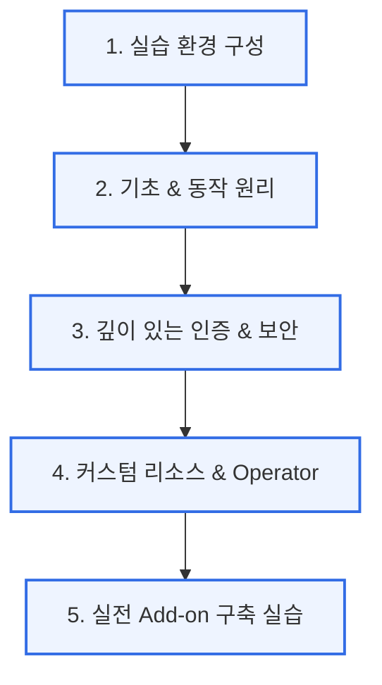

# ☸️ Kubernetes 심화 과정 학습 아카이브

본 아카이브는 **Kubernetes(K8s)의 고급 아키텍처**, **인증 및 보안 메커니즘**, **Operator 개발**, 그리고 **실전 엔터프라이즈 환경 구축**에 이르기까지 깊이 있는 지식을 학습하고 관리하는 전용 공간입니다.

---

## 💡 학습 로드맵 및 구성

본 아카이브는 체계적인 학습을 위해 총 **5개의 전문 영역**으로 구성되어 있습니다. 각 상단 메뉴를 선택한 뒤 관련 탭을 클릭하여 학습을 진행할 수 있습니다.

---

## 📂 핵심 학습 주제 및 상세 내용

### 🛠️ 1. 실습 환경 구성 (Environment)
안정적이고 표준화된 실습 진행을 위한 Kubernetes 클러스터 설치 환경과 필수 Core Add-on 세팅을 다룹니다.

### 📚 2. 기초 이론 및 핵심 아키텍처 (Basics)
*   **kubectl 동작 원리**: REST API 호출 흐름 분석
*   **리소스 맵 & 컴포넌트**: Control Plane 및 Worker Node의 상호작용
*   **Stateless vs Stateful**: StatefulSet의 영속성 원리 및 Headless Service의 DNS 역할
*   **패키지 관리**: Helm을 통한 리소스 패키징 기법

### 🔒 3. 인증 및 보안 (Security & IAM)
Kubernetes 심화 과정의 중추적인 핵심 파트입니다.
*   **보안 기초**: 대칭키/비대칭키, SSL/TLS 핸드셰이크, 신뢰 체인 및 CA 원리
*   **K8s API 인증**: client-cert, mtLS, Webhook Token, OIDC 연동
*   **인증서 관리 실무**: kubeadm 인증서 유효기간 확인, 갱신 및 커스텀 User 생성 실습
*   **엔터프라이즈 IAM**: Keycloak을 활용한 Single Sign-On(SSO)과 K8s 통합

### 🧩 4. Operator 패턴 개발 (Operator & CRD)
*   **CRD (Custom Resource Definition)**: 사용자 정의 리소스 스키마 설계
*   **Controller Pattern**: Reconcile 루프를 통한 선언적 상태 유지
*   **프로메테우스 Operator**: 엔터프라이즈 모니터링 환경 자동화 구축

### 🧪 5. 실무 Add-on 구축 (Labs)
클러스터 운영에 필수적인 핵심 에드온들을 직접 템플릿(YAML)으로 실습합니다.
*   Metric Server, Kubernetes Dashboard
*   MetalLB (LoadBalancer), Ingress-NGINX (L7 Gateway)
*   NFS Storage Provisioner
*   kew & kubectl plugin 개발 실무
