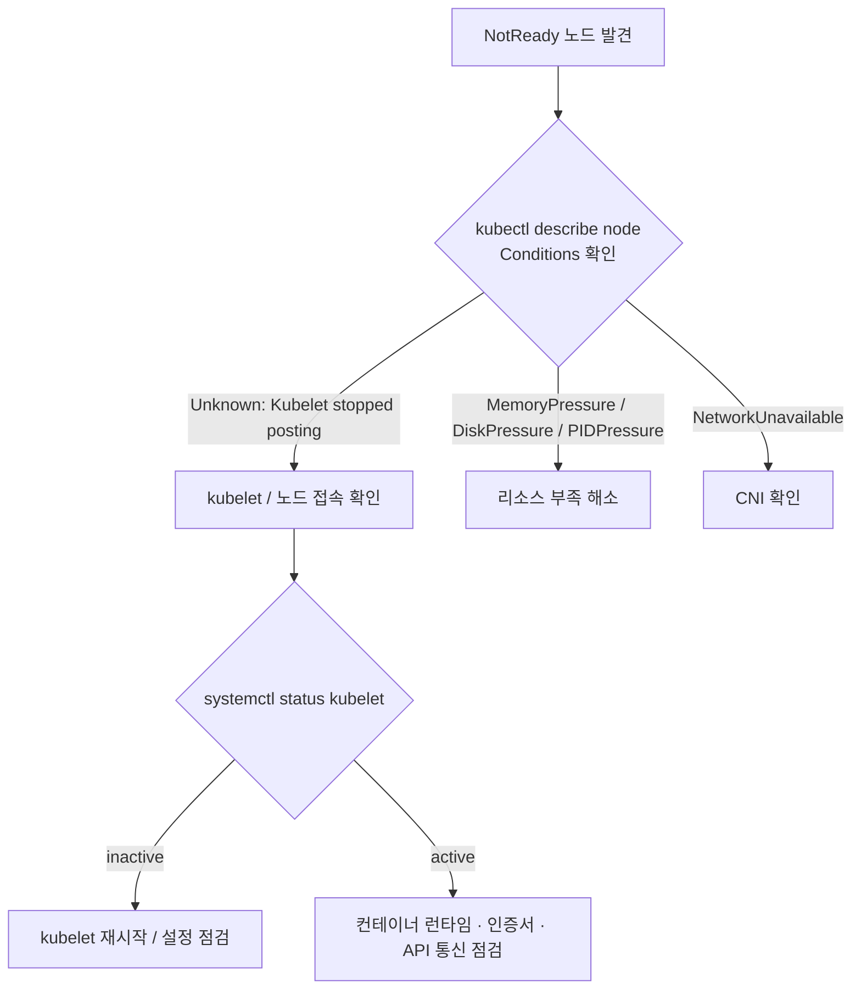

# Use Case 3. Kubernetes Node NotReady 해결 방법

> 📎 참고 자료: <https://lnkd.in/gdH9SVuN>

노드 상태가 `NotReady` 가 되는 원인을 체계적으로 좁혀가는 트러블슈팅 절차입니다.

---

## 1. NotReady 란?

kubelet 이 API Server 에 주기적으로 상태(Lease/NodeStatus)를 보고하지 못하거나, 보고한 **Ready 컨디션이 False/Unknown** 인 상태입니다. Node Controller 는 일정 시간(기본 40초 grace) 후 노드를 `NotReady` 로 표시하고, 이후 해당 노드의 Pod 를 eviction 합니다.



---

## 2. 단계별 점검

### Step 1. 컨디션 확인
```bash
kubectl get nodes
kubectl describe node <node> | sed -n '/Conditions/,/Addresses/p'
kubectl get events --field-selector involvedObject.name=<node>
```

### Step 2. 노드에 접속하여 kubelet 확인
```bash
systemctl status kubelet
journalctl -u kubelet -n 100 --no-pager
```

### Step 3. 컨테이너 런타임 확인
```bash
systemctl status containerd
crictl ps
crictl info
```

### Step 4. 리소스 부족 확인
```bash
df -h        # DiskPressure (/var/lib/kubelet, /var/lib/containerd)
free -m      # MemoryPressure
```

### Step 5. 네트워크 / CNI / 인증서
```bash
ls /etc/cni/net.d/
kubectl get pods -n kube-system -o wide | grep <node>
openssl x509 -in /var/lib/kubelet/pki/kubelet-client-current.pem -noout -dates
curl -k https://<apiserver>:6443/healthz
```

---

## 3. 자주 만나는 원인 표

| 증상 (로그/컨디션) | 원인 | 조치 |
|--------------------|------|------|
| `Kubelet stopped posting node status` | kubelet 다운 | `systemctl restart kubelet`, 로그 확인 |
| `container runtime is down` | containerd 장애 | 런타임 재시작 |
| `DiskPressure=True` | 디스크 사용량 임계 초과 | 이미지/로그 정리 (`crictl rmi --prune`) |
| `MemoryPressure=True` | 노드 메모리 부족 | 워크로드 이동, limits 조정 |
| `cni plugin not initialized` | CNI 미설치/오류 | CNI DaemonSet 점검 |
| `x509: certificate has expired` | kubelet 인증서 만료 | 인증서 갱신 (28번 문서 참고) |
| swap 활성화 | kubelet 기동 실패 | `swapoff -a` 및 `/etc/fstab` 수정 |

---

## 4. 복구 후 확인

```bash
kubectl uncordon <node>      # cordon 했다면 해제
kubectl get nodes -w
```

> 복구가 불가능하면 `kubectl drain <node> --ignore-daemonsets --delete-emptydir-data` 후 노드를 교체하세요.
