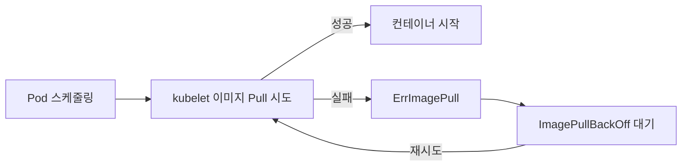

# Use Case 4. Kubernetes ImagePullBackOff 해설

> 📎 참고 자료: <https://lnkd.in/gW8Q9c29>

Pod 가 `ErrImagePull` → `ImagePullBackOff` 상태가 되는 이유와 해결법입니다.

---

## 1. 상태의 의미

| 상태 | 의미 |
|------|------|
| `ErrImagePull` | 이미지를 가져오는 시도가 **실패**한 순간 |
| `ImagePullBackOff` | 실패 후 kubelet 이 **지수 백오프**(10s, 20s, 40s … 최대 5분)로 재시도 대기 중 |



---

## 2. 진단 순서

```bash
kubectl get pod <pod>
kubectl describe pod <pod>      # Events 의 Failed / Back-off 메시지가 핵심
```

Events 예시:
```
Failed to pull image "myapp:v2": rpc error: code = NotFound ... not found
Failed to pull image "registry.example.com/app": ... pull access denied, authorization failed
```

---

## 3. 원인별 해결

| 원인 | 메시지 단서 | 해결 |
|------|-------------|------|
| **이미지/태그 오타** | `not found`, `manifest unknown` | 이름·태그 수정 (`latest` 남용 주의) |
| **프라이빗 레지스트리 인증 실패** | `unauthorized`, `pull access denied` | `imagePullSecrets` 설정 |
| **레지스트리 접근 불가** | `i/o timeout`, `no such host` | 노드 DNS/방화벽/프록시 점검 |
| **Rate limit** | `toomanyrequests` (Docker Hub) | 로그인 pull, 사설 미러 사용 |
| **아키텍처 불일치** | `no matching manifest for linux/arm64` | 멀티 아키텍처 이미지 사용 |
| **TLS 인증서 문제** | `x509: certificate signed by unknown authority` | 노드에 CA 신뢰 등록 |

### imagePullSecrets 설정

```bash
kubectl create secret docker-registry regcred \
  --docker-server=registry.example.com \
  --docker-username=<user> \
  --docker-password=<password> \
  -n <namespace>
```

```yaml
spec:
  imagePullSecrets:
  - name: regcred
  containers:
  - name: app
    image: registry.example.com/team/app:1.0.0
```

---

## 4. 노드에서 직접 확인

```bash
crictl pull registry.example.com/team/app:1.0.0
```

> Pod 가 아닌 **노드(kubelet/containerd)** 가 pull 하므로, 노드에서 재현하는 것이 가장 빠릅니다.

---

## 5. 예방 팁

- 태그는 불변 버전 또는 digest(`@sha256:...`)를 사용
- `imagePullPolicy` 의미 확인: `IfNotPresent` / `Always` / `Never`
- 사설 레지스트리 secret 은 네임스페이스마다 필요 (ServiceAccount 에 `imagePullSecrets` 연결 가능)
