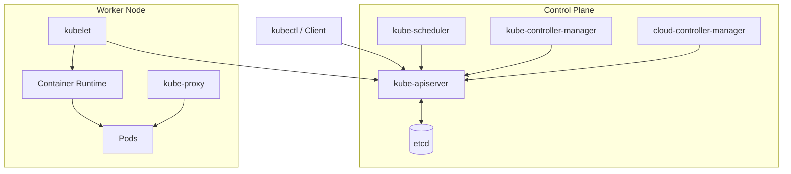
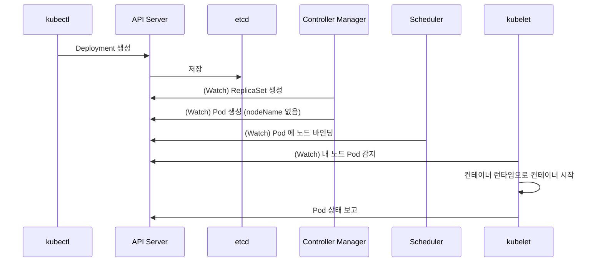

# Use Case 5. Kubernetes 아키텍처 속성 과정

> 📎 참고 자료: <https://lnkd.in/gseEj3wD>

Kubernetes 클러스터를 구성하는 컴포넌트와 요청이 처리되는 흐름을 한 번에 훑어봅니다. (상세는 03-k8s-components 문서 참고)

---

## 1. 큰 그림

---

## 2. 컴포넌트 역할

### Control Plane

| 컴포넌트 | 역할 |
|----------|------|
| **kube-apiserver** | 모든 통신의 중심. 인증·인가·Admission, REST API 제공. etcd 와 통신하는 **유일한** 컴포넌트 |
| **etcd** | 클러스터 상태를 저장하는 분산 Key-Value 저장소 (Raft 합의) |
| **kube-scheduler** | 미배정 Pod 를 적절한 노드에 배치 (필터링 → 스코어링) |
| **kube-controller-manager** | Deployment, ReplicaSet, Node, Job 등 컨트롤러 루프 실행 |
| **cloud-controller-manager** | 클라우드의 LB, 노드, 라우트 연동 |

### Worker Node

| 컴포넌트 | 역할 |
|----------|------|
| **kubelet** | 노드 에이전트. PodSpec 대로 컨테이너를 실행·감시, 상태 보고 |
| **kube-proxy** | Service 의 가상 IP 를 iptables/IPVS 규칙으로 구현 |
| **Container Runtime** | containerd, CRI-O 등. CRI 를 통해 kubelet 과 연동 |

---

## 3. `kubectl apply` 한 번에 일어나는 일

핵심 원리는 **선언적 상태(Desired State) + Watch 기반 컨트롤 루프(Reconcile)** 입니다.

---

## 4. 기억할 포인트

- 컴포넌트끼리 직접 통신하지 않고 **API Server 를 통해서만** 상태를 주고받습니다.
- etcd 장애 = 클러스터 제어 불능 → 백업과 HA 구성이 필수입니다.
- 애드온(CoreDNS, CNI, Metrics Server 등)은 Pod 형태로 클러스터 위에서 동작합니다.
