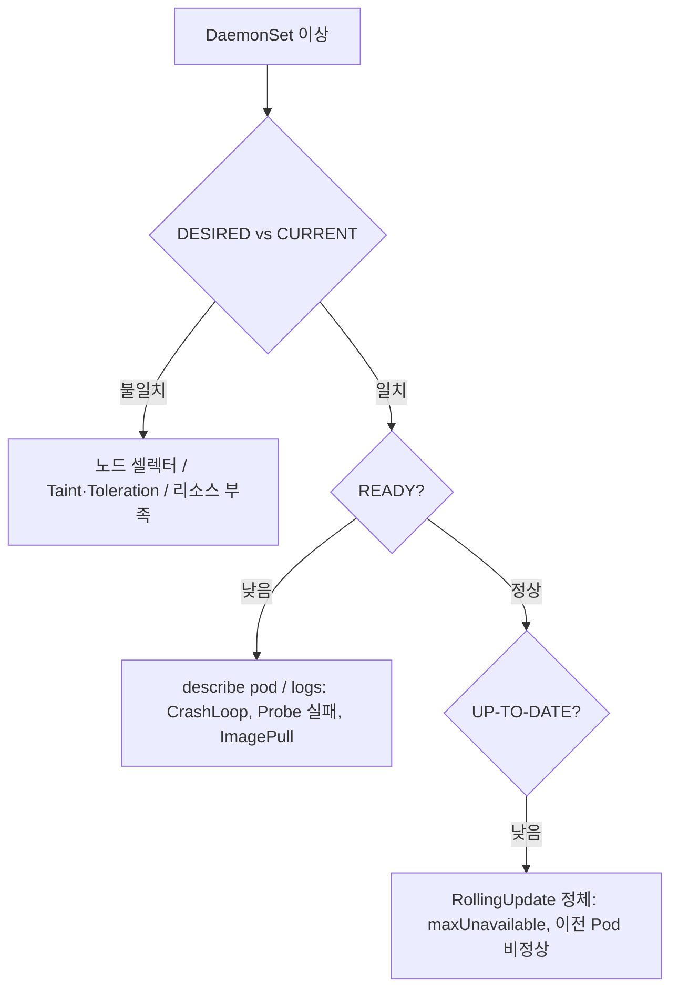

# Use Case 6. 비정상 Kubernetes DaemonSet 트러블슈팅

> 📎 참고 자료: <https://lnkd.in/geGgkXKe>

DaemonSet 은 **모든(또는 선택된) 노드에 Pod 를 1개씩** 실행합니다. 로그 수집기, CNI, 모니터링 에이전트 등에 쓰이므로 문제가 생기면 영향 범위가 큽니다.

---

## 1. 먼저 숫자를 읽는다

```bash
kubectl get ds -A
# NAME        DESIRED  CURRENT  READY  UP-TO-DATE  AVAILABLE  NODE SELECTOR
```

| 필드 | 의미 |
|------|------|
| `DESIRED` | 스케줄되어야 하는 노드 수 |
| `CURRENT` | 실제 생성된 Pod 수 |
| `READY` | Ready 상태 Pod 수 |
| `UP-TO-DATE` | 최신 템플릿으로 갱신된 Pod 수 |

`DESIRED ≠ CURRENT` → **스케줄링** 문제, `CURRENT ≠ READY` → **Pod 기동/Probe** 문제.



---

## 2. 원인별 점검

### (1) 일부 노드에 Pod 가 없음
```bash
kubectl describe ds <name> -n <ns>
kubectl get nodes --show-labels
kubectl describe node <node> | grep -i taint
```
- **Taint**: control-plane 등 taint 노드에는 `tolerations` 필요
- **nodeSelector / nodeAffinity** 불일치
- 노드 리소스 부족 (DaemonSet Pod 도 requests 를 만족해야 함)

```yaml
spec:
  template:
    spec:
      tolerations:
      - key: node-role.kubernetes.io/control-plane
        operator: Exists
        effect: NoSchedule
```

### (2) Pod 가 CrashLoopBackOff / Not Ready
```bash
kubectl logs <pod> -n <ns> --previous
kubectl describe pod <pod> -n <ns>
```
- `hostPath`, `hostNetwork`, `privileged` 권한/경로 문제
- 포트 충돌 (`hostPort` 사용 시)
- Liveness/Readiness probe 설정 오류

### (3) 롤아웃이 멈춤
```bash
kubectl rollout status ds/<name> -n <ns>
kubectl rollout history ds/<name> -n <ns>
```
- `updateStrategy.rollingUpdate.maxUnavailable` 확인 (기본 1)
- 한 노드의 Pod 가 계속 Not Ready 면 다음 노드로 진행하지 못함
- `OnDelete` 전략이면 수동으로 Pod 삭제 필요

```bash
kubectl rollout undo ds/<name> -n <ns>
```

---

## 3. 트러블슈팅 사례

### 사례 1. control-plane 노드에만 Pod 가 없음 (Taint)

- **증상**: 노드 5대(control-plane 1 + worker 4)인데 `DESIRED=4, CURRENT=4`. 로그 수집기가 control-plane 로그를 못 가져옴.
- **진단**
  ```bash
  kubectl describe node cp-1 | grep -i taint
  # Taints: node-role.kubernetes.io/control-plane:NoSchedule
  ```
- **원인**: control-plane 노드의 `NoSchedule` taint 를 DaemonSet 이 tolerate 하지 않음.
- **해결**: `tolerations` 추가 후 `kubectl apply` → `DESIRED=5` 로 증가 확인.

### 사례 2. 특정 노드에서만 CrashLoopBackOff (hostPath / 권한)

- **증상**: `READY` 가 `DESIRED-1`. 한 노드의 Pod 만 `CrashLoopBackOff`.
- **진단**
  ```bash
  kubectl get pods -n logging -o wide | grep -v Running
  kubectl logs <pod> -n logging --previous
  # open /var/log/containers: permission denied  (또는 no such file or directory)
  ```
- **원인**: 해당 노드의 컨테이너 런타임이 다른 경로(`/var/log/pods`)를 쓰거나, SELinux/AppArmor 가 hostPath 접근을 차단.
- **해결**: 노드 설정을 통일하거나 마운트 경로 수정, 필요 시 `securityContext` 조정. 노드 간 OS/런타임 편차를 먼저 의심합니다.

### 사례 3. 신규 노드 추가 후 Pod 가 Pending (리소스 부족)

- **증상**: 노드 증설 직후 DaemonSet Pod 가 `Pending`, 일반 워크로드가 이미 노드를 가득 채움.
- **진단**
  ```bash
  kubectl describe pod <pod> | grep -A5 Events
  # 0/1 nodes are available: 1 Insufficient cpu.
  ```
- **원인**: DaemonSet Pod 도 `requests` 를 만족해야 스케줄됨. 일반 Pod 가 먼저 자리를 차지함.
- **해결**: 에이전트에 `priorityClassName: system-node-critical` 을 부여하면 낮은 우선순위 Pod 를 preempt 하고 배치됩니다. requests 값 자체를 줄이는 것도 방법입니다.

### 사례 4. 롤링 업데이트가 중간에서 멈춤

- **증상**: `UP-TO-DATE` 가 3 에서 정체, `rollout status` 가 계속 대기.
- **진단**
  ```bash
  kubectl rollout status ds/node-agent -n monitoring
  kubectl get pods -n monitoring -o wide     # 새 버전 Pod 중 Not Ready 확인
  ```
- **원인**: 새 이미지의 readinessProbe 실패(잘못된 설정 값) → `maxUnavailable: 1` 이라 다음 노드로 진행하지 못함.
- **해결**: 즉시 `kubectl rollout undo ds/node-agent -n monitoring` 로 복구 후 설정 수정. 대규모 클러스터는 `maxUnavailable: 10%` 처럼 비율로 지정합니다.

### 사례 5. hostPort 충돌로 Pod 시작 실패

- **증상**: 일부 노드에서 Pod 가 계속 실패하며 `Pending` 또는 이벤트에 포트 관련 메시지.
- **진단**
  ```bash
  kubectl describe pod <pod> | grep -i "port"
  # didn't have free ports for the requested pod ports
  ss -ltnp | grep :9100        # 노드에서 직접 확인
  ```
- **원인**: 노드에 이미 같은 포트를 쓰는 프로세스(예: 직접 설치한 node_exporter)나 다른 DaemonSet 이 존재.
- **해결**: 기존 프로세스 중지 또는 포트 변경. `hostNetwork` 사용 시 특히 충돌하기 쉽습니다.

### 사례 6. 노드 drain 이 멈춤

- **증상**: `kubectl drain` 이 DaemonSet Pod 때문에 진행되지 않음.
- **원인/해결**: DaemonSet Pod 는 삭제해도 즉시 재생성되므로 drain 대상에서 제외해야 합니다.
  ```bash
  kubectl drain <node> --ignore-daemonsets --delete-emptydir-data
  ```

---

## 4. 체크리스트

- [ ] `DESIRED / CURRENT / READY` 숫자 비교
- [ ] 문제 노드의 Taint, Label, 리소스 확인
- [ ] 문제 Pod 의 `describe` Events 와 `logs --previous`
- [ ] PriorityClass 설정 (중요한 에이전트는 `system-node-critical` 고려)
- [ ] 업데이트 전략과 `maxUnavailable`
