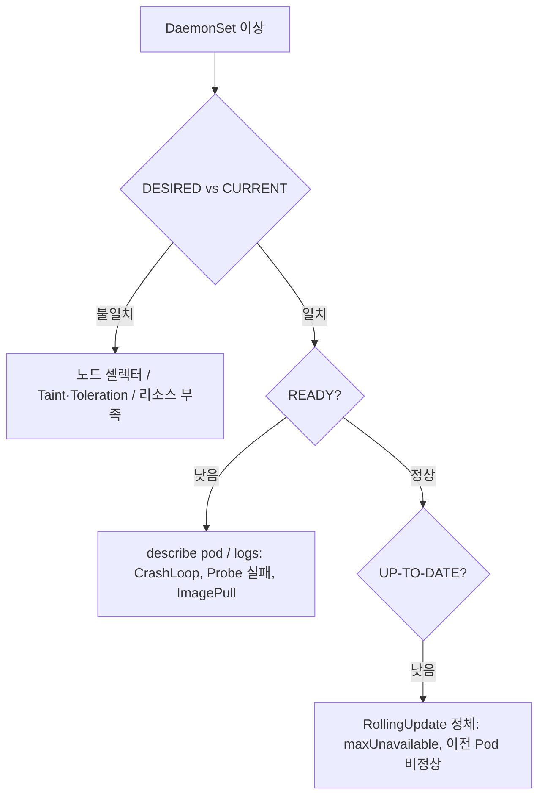

# Use Case 6. 비정상 Kubernetes DaemonSet 트러블슈팅

> 📎 참고 자료: <https://lnkd.in/geGgkXKe>

DaemonSet 은 **모든(또는 선택된) 노드에 Pod 를 1개씩** 실행합니다. 로그 수집기, CNI, 모니터링 에이전트 등에 쓰이므로 문제가 생기면 영향 범위가 큽니다.

---

## 1. 먼저 숫자를 읽는다

```bash
kubectl get ds -A
# NAME        DESIRED  CURRENT  READY  UP-TO-DATE  AVAILABLE  NODE SELECTOR
```

| 필드 | 의미 |
|------|------|
| `DESIRED` | 스케줄되어야 하는 노드 수 |
| `CURRENT` | 실제 생성된 Pod 수 |
| `READY` | Ready 상태 Pod 수 |
| `UP-TO-DATE` | 최신 템플릿으로 갱신된 Pod 수 |

`DESIRED ≠ CURRENT` → **스케줄링** 문제, `CURRENT ≠ READY` → **Pod 기동/Probe** 문제.



---

## 2. 원인별 점검

### (1) 일부 노드에 Pod 가 없음
```bash
kubectl describe ds <name> -n <ns>
kubectl get nodes --show-labels
kubectl describe node <node> | grep -i taint
```
- **Taint**: control-plane 등 taint 노드에는 `tolerations` 필요
- **nodeSelector / nodeAffinity** 불일치
- 노드 리소스 부족 (DaemonSet Pod 도 requests 를 만족해야 함)

```yaml
spec:
  template:
    spec:
      tolerations:
      - key: node-role.kubernetes.io/control-plane
        operator: Exists
        effect: NoSchedule
```

### (2) Pod 가 CrashLoopBackOff / Not Ready
```bash
kubectl logs <pod> -n <ns> --previous
kubectl describe pod <pod> -n <ns>
```
- `hostPath`, `hostNetwork`, `privileged` 권한/경로 문제
- 포트 충돌 (`hostPort` 사용 시)
- Liveness/Readiness probe 설정 오류

### (3) 롤아웃이 멈춤
```bash
kubectl rollout status ds/<name> -n <ns>
kubectl rollout history ds/<name> -n <ns>
```
- `updateStrategy.rollingUpdate.maxUnavailable` 확인 (기본 1)
- 한 노드의 Pod 가 계속 Not Ready 면 다음 노드로 진행하지 못함
- `OnDelete` 전략이면 수동으로 Pod 삭제 필요

```bash
kubectl rollout undo ds/<name> -n <ns>
```

---

## 3. 체크리스트

- [ ] `DESIRED / CURRENT / READY` 숫자 비교
- [ ] 문제 노드의 Taint, Label, 리소스 확인
- [ ] 문제 Pod 의 `describe` Events 와 `logs --previous`
- [ ] PriorityClass 설정 (중요한 에이전트는 `system-node-critical` 고려)
- [ ] 업데이트 전략과 `maxUnavailable`
