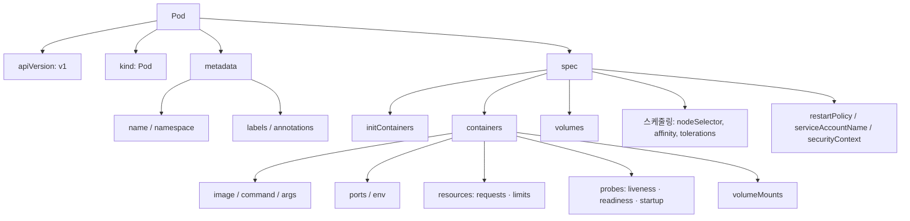

# Use Case 7. pod.yaml 파일 구조 분석

> 📎 참고 자료: <https://lnkd.in/gVRYM78g>

모든 Kubernetes 매니페스트의 기본이 되는 Pod 정의를 필드별로 나누어 살펴봅니다.

---

## 1. 4개의 최상위 필드

| 필드 | 설명 |
|------|------|
| `apiVersion` | 사용할 API 그룹/버전 (Pod 는 `v1`) |
| `kind` | 오브젝트 종류 (`Pod`) |
| `metadata` | 이름, 네임스페이스, 레이블, 어노테이션 |
| `spec` | 원하는 상태(Desired State). **가장 중요한 영역** |

> `status` 는 클러스터가 채우는 필드이므로 직접 작성하지 않습니다.

---

## 2. 전체 예제

```yaml
apiVersion: v1
kind: Pod
metadata:
  name: web-pod
  namespace: demo
  labels:
    app: web
    tier: frontend
  annotations:
    owner: platform-team
spec:
  serviceAccountName: web-sa
  restartPolicy: Always
  nodeSelector:
    disktype: ssd
  initContainers:
  - name: init-wait
    image: busybox:1.36
    command: ["sh", "-c", "until nslookup db; do sleep 2; done"]
  containers:
  - name: nginx
    image: nginx:1.27
    imagePullPolicy: IfNotPresent
    ports:
    - containerPort: 80
    env:
    - name: APP_ENV
      value: production
    resources:
      requests:
        cpu: 100m
        memory: 128Mi
      limits:
        cpu: 500m
        memory: 256Mi
    readinessProbe:
      httpGet:
        path: /
        port: 80
    livenessProbe:
      httpGet:
        path: /
        port: 80
      initialDelaySeconds: 10
    volumeMounts:
    - name: html
      mountPath: /usr/share/nginx/html
  volumes:
  - name: html
    emptyDir: {}
```

---

## 3. 구조 한눈에 보기



---

## 4. 주요 필드 해설

| 필드 | 포인트 |
|------|--------|
| `labels` | Service·Deployment 의 selector 가 Pod 를 찾는 기준 |
| `initContainers` | 메인 컨테이너 전에 **순차** 실행되며, 모두 성공해야 시작 |
| `resources.requests` | 스케줄링 기준값 / `limits` 는 실행 중 상한 (QoS 클래스 결정) |
| `readinessProbe` | 실패 시 Service 엔드포인트에서 제외 |
| `livenessProbe` | 실패 시 컨테이너 재시작 |
| `restartPolicy` | `Always`(기본) / `OnFailure` / `Never` |
| `volumes` + `volumeMounts` | 볼륨 선언은 Pod 레벨, 마운트는 컨테이너 레벨 |

---

## 5. 실무 팁

```bash
kubectl run web-pod --image=nginx --dry-run=client -o yaml > pod.yaml   # 템플릿 생성
kubectl explain pod.spec.containers.resources                          # 필드 문서 확인
kubectl apply -f pod.yaml --dry-run=server                              # 서버 측 검증
```

- 실제 운영에서는 Pod 를 직접 만들기보다 **Deployment / StatefulSet** 의 `template` 안에 같은 구조로 정의합니다.
- 필드 위치를 헷갈리면 `kubectl explain` 이 가장 정확한 레퍼런스입니다.
